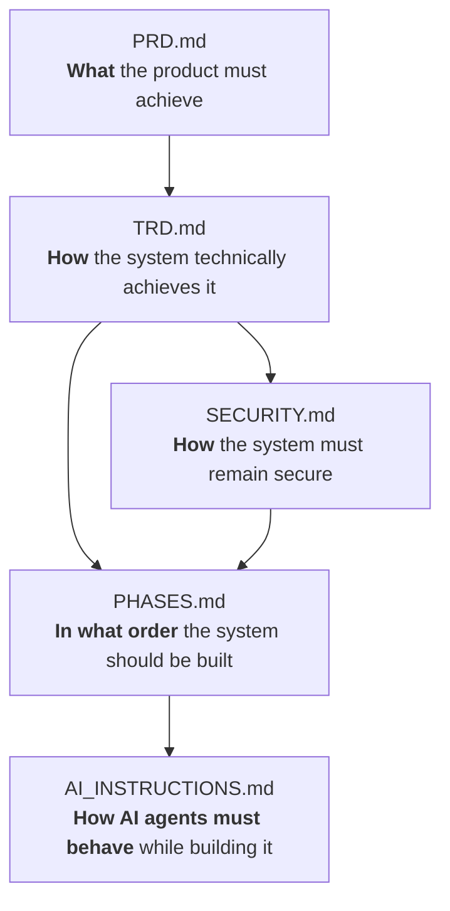

# AI Contributor Instructions (AI_INSTRUCTIONS) — SAMANVAYA · SŪTRA

> **File:** `AI_INSTRUCTIONS.md`  
> **Purpose:** Set research, implementation, security, and verification expectations for AI coding agents.  
> **Audience:** AI agents (Antigravity, Codex, Cursor, Claude Code, Jules) contributing to SŪTRA.  
> **Status:** Governing Engineering Instructions — Strictly Enforced.  

The root [`AGENTS.md`](AGENTS.md) supplies the maintainer's mandatory Graphify token reduction protocol for this repository. Follow it for codebase navigation before reading files and after making code changes. This document defines the engineering behavioral rules; it does not replace repository-specific instructions.

---



---

## Preamble

This document defines the strict, non-negotiable operational rules for every AI coding agent (including Google Antigravity, Cursor, OpenAI Codex, Claude Code, Google Jules, and any CLI- or API-based agent) operating on the **SAMANVAYA · SŪTRA** codebase (historically known as *AgentBridge*).

The foundational principle of this project is:

> **SŪTRA is the control plane. The coding agent is the coding intelligence.**

As an AI coding agent working on SŪTRA, you are writing the software that controls, supervises, and isolates other AI agents. A security vulnerability, architectural regression, or reckless assumption here endangers developer workstations and intellectual property.

You must follow every rule in this document without exception.

---

## Document Ecosystem & Authority

Before reading further, understand the hierarchy and relationship between the five foundational engineering documents:

* **`PRD.md` (Product Requirements Document):** Defines **WHAT** the product must achieve, who the users are, core use cases, and functional/non-functional requirements.
* **`TRD.md` (Technical Requirements Document):** Defines **HOW** the system technically achieves those requirements, detailing system topology, component architecture, protocols, and data models.
* **`SECURITY.md` (Security Architecture & Threat Model):** Defines **HOW THE SYSTEM REMAINS SECURE**, establishing trust boundaries, command validation pipelines, path isolation invariants, and secret defenses.
* **`PHASES.md` (Implementation Roadmap):** Defines **IN WHAT ORDER** the system is built, providing structured milestones from Phase 0 to Phase 12 with explicit definitions of done.
* **`AI_INSTRUCTIONS.md` (This Document):** Defines **HOW AI AGENTS MUST BEHAVE** while reading, planning, writing, testing, and verifying code across all phases.

---

## Information Certainty Classification Matrix

Whenever you encounter external APIs, agent interfaces, CLI flags, or library capabilities, you must never convert uncertainty into asserted fact. Classify all technical information according to this explicit scale:

| Classification | Definition | Required Action |
| :--- | :--- | :--- |
| **Verified** | Confirmed from local code on disk, active unit tests, or official vendor documentation. | Safe to reference and implement immediately. |
| **Likely / Documentation-Dependent** | Described in authoritative vendor guides, but requires runtime environment verification (e.g., binary present in `PATH`). | Check availability locally before invoking (`shutil.which` or CLI check). |
| **Experimental** | Documented as preview, beta, or unstable (e.g., Scenario C GUI automation, alpha CLI flags). | Wrap in feature flags and safe fallback blocks. |
| **Planned** | Specified in AgentBridge architecture or roadmap, but not yet implemented. | Clearly mark as planned; do not claim it exists or runs today. |
| **Unknown** | Unverified assumption, memory recall, or speculative syntax. | **STOP AND RESEARCH**. Do not guess or hallucinate. |

---

## The 30 Core Operational Rules

---

### RULE 1 — NEVER HALLUCINATE
The AI must never invent:
* Non-existent APIs, methods, or parameters
* Non-existent CLI commands, subcommands, or flags
* Non-existent third-party libraries or package dependencies
* Non-existent agent capabilities or protocols
* Non-existent configuration variables or environment keys
* Non-existent test results or benchmark figures
* Non-existent implementation status (claiming a planned feature is implemented)
* Non-existent vendor quotas or pricing tiers

**When uncertain: VERIFY. Do not guess.**

---

### RULE 2 — NO BEATING AROUND THE BUSH
Communicate with technical precision, directness, and actionability. Avoid conversational filler, hedging language, or passive apologies.

* **Unacceptable:** *"There might possibly be a potential issue that could perhaps be related to something in the path handling..."*
* **Mandatory:** *"The path check fails because `D:\Projects\App` contains a symlink pointing to `C:\Secrets`, which escapes the registered workspace boundary."*

Every technical statement must be direct, specific, and actionable.

---

### RULE 3 — RESEARCH BEFORE CODING
Before writing or modifying a single line of code, the AI **MUST** complete a 12-step research procedure:

1. Inspect the complete repository structure and directory tree.
2. Inspect all relevant existing source code files.
3. Inspect current documentation (`PRD.md`, `TRD.md`, `SECURITY.md`, `PHASES.md`, `README.md`).
4. Inspect configuration templates (`.env.example`, `config.example.yaml`).
5. Inspect existing unit tests and test suites.
6. Inspect the existing system architecture and sequence flows.
7. Research official documentation for external tools and agents when involved.
8. Research existing prior art implementations when relevant.
9. Identify architectural and platform constraints (e.g., Windows path handling, loopback bindings).
10. Identify all direct and indirect dependencies.
11. Identify security impacts and threat boundary crossings.
12. Formulate a structured, minimal implementation plan.

**ONLY AFTER THIS RESEARCH IS COMPLETE MAY CODING BEGIN.**

---

### RULE 4 — VERIFY CURRENT DOCUMENTATION
Do not rely on stale memory for external agent interfaces. Verify current official documentation for:
* **Google Antigravity:** CLI commands (`agy`), slash commands, settings in `~/.gemini/antigravity-cli/settings.json`, and Python SDK.
* **Cursor:** CLI interface (`agent -p`), `--force` flag, `--output-format json`, `agent login`, and `CURSOR_API_KEY`.
* **Claude Code:** CLI interface (`claude -p`), `--allowedTools`, `--output-format stream-json`, `--bare`, and `--continue`.
* **Google Jules:** `@google/jules` npm package, `jules login`, `jules remote new --repo <repo> --session "<task>"`, and `jules remote pull`.
* **OpenAI / Codex:** API response schemas, structured outputs, and Assistant / Agent protocols.
* **Protocols:** Model Context Protocol (MCP) and Agent Client Protocol (ACP).
* **Platforms:** Telegram Bot API (webhook vs. long-polling, inline keyboards), GitHub REST API, and Ollama REST API.

---

### RULE 5 — PLAN BEFORE MODIFYING
Before making any file modifications, produce an internal structured plan:
```text
1. Current State: What code/file currently exists and how does it behave?
2. Problem: What specific requirement, bug, or phase milestone is being addressed?
3. Proposed Change: Exactly what functions, classes, or files will be created or modified?
4. Files Affected: Explicit list of file paths.
5. Dependencies: What packages or modules are required?
6. Security Impact: Does this cross a trust boundary, execute a command, or touch the disk?
7. Tests Required: What unit tests will prove correctness and security?
```
Do not modify unrelated files outside the declared scope of the plan.

---

### RULE 6 — MINIMAL CHANGES
Change the smallest number of files and lines necessary to accomplish the objective.
* Do **not** rewrite working code.
* Do **not** gratuitously refactor adjacent modules.
* Do **not** rename files or restructure directories without explicit requirement.
* Do **not** introduce new third-party dependencies when standard library primitives suffice.
* Do **not** introduce architectural abstractions for hypothetical future requirements.

---

### RULE 7 — HUMAN-READABLE CODE
All function, method, class, and variable names must immediately communicate their purpose to human engineers.

* **Prefer:**
  ```python
  register_device()
  discover_projects()
  validate_workspace_path()
  send_permission_request()
  get_project_tree()
  create_git_branch()
  ```
* **Avoid:**
  ```python
  do_task()
  process_data()
  handle()
  execute()
  run()
  temp_var
  res
  ```

---

### RULE 8 — FILE AND FOLDER NAMES MUST BE MEANINGFUL
Directory and file names must clearly explain their architectural responsibility.

* **Good:**
  `device_manager.py`, `workspace_manager.py`, `permission_engine.py`, `agent_adapter.py`, `project_discovery.py`, `connector_registry.py`.
* **Prohibited:**
  `misc/`, `stuff/`, `helpers2/`, `new/`, `temp/`, `test2/`, `final/`, `utils123.py`.

Never create multiple directories or modules with overlapping, ambiguous responsibilities.

---

### RULE 9 — MINIMIZE COMMENTS
Code should explain itself through clean architecture, meaningful names, small functions, and simple logic.

* Write comments **only** when explaining non-obvious rationale, complex mathematical/cryptographic operations, or workarounds for external platform bugs.
* **Prohibited:**
  ```python
  # Increment i by 1
  i += 1
  # Connect to database
  db.connect()
  ```
Avoid comment noise.

---

### RULE 10 — NO OVER-ENGINEERING
Build the simplest viable technical solution that satisfies the functional, performance, and security requirements.
* Do **not** introduce microservices when a modular monolith suffices.
* Do **not** add distributed message brokers (Kafka, RabbitMQ) when an in-memory queue or SQLite WAL suffices.
* Do **not** create deep, multi-tiered inheritance hierarchies when a simple protocol or function suffices.
* Do **not** add complex caching layers before performance bottlenecks are measured.

---

### RULE 11 — SECURITY BEFORE CONVENIENCE
Never weaken security to make a feature easier to implement, test, or demonstrate.
* Never disable path validation to "fix" a test.
* Never bind services to public IP addresses (`0.0.0.0`) when loopback (`127.0.0.1`) is specified.
* Never store credentials in plaintext config files or version control.
* Never bypass permission hooks for dangerous commands.

---

### RULE 12 — NEVER EXECUTE UNTRUSTED INPUT DIRECTLY
Under no circumstances may the AI execute raw user strings directly through the operating system shell.

* **Prohibited:**
  ```python
  os.system(user_command)
  subprocess.Popen(user_command, shell=True)
  ```
* **Mandatory:**
  All commands must be tokenized into discrete argument arrays (`shlex.split`), validated against allowlists, evaluated by the deterministic policy engine, and executed with `shell=False`.

---

### RULE 13 — NEVER ACCESS THE WHOLE COMPUTER WITHOUT AUTHORIZATION
Filesystem operations must strictly reside within explicitly registered workspace directories.
* The AI must never read, write, scan, or traverse directories outside registered workspaces.
* The AI must never register or attempt to access entire drive roots (`C:\`, `D:\`, `/`).
* Any path escaping registered roots must raise an immediate, non-recoverable `PermissionError`.

---

### RULE 14 — NEVER PUSH TO GITHUB (MANDATORY SAFEGUARD)
This is an absolute, non-negotiable safety invariant. The AI must **NEVER**:
* Execute `git push`
* Execute `git push --force`
* Create or delete remote branches
* Create GitHub Pull Requests
* Merge GitHub Pull Requests

**UNLESS the human user explicitly instructs the AI to perform that exact operation in the current prompt.**

Even if valid GitHub tokens or SSH keys exist in the environment, the default behavior is:
```text
Modify locally ──> Test locally ──> Show status & diff ──> STOP.
```
The human developer retains 100% authority over what is pushed to remote repositories.

---

### RULE 15 — NEVER COMMIT SECRETS
Before staging or committing any files to Git, the AI must verify that candidate files contain no secrets.
Strictly exclude:
* `.env`, `.env.*`, `*.env`
* `*.pem`, `*.key`, `*.pkcs12`, `id_rsa*`, `id_ed25519*`
* Files containing `secret`, `credential`, `token`, `password` in name or content
* Any file matched by `.gitignore`

---

### RULE 16 — TEST AFTER CHANGES
Whenever code is modified, the AI must execute relevant test suites to verify correctness:
```text
Modify ──> Run Tests ──> Inspect Output ──> Fix Failures ──> Verify
```
* The AI must **never** state *"Tests passed"* unless the test command was actually executed and produced exit code 0.
* If a test fails, report the exact failure traceback and address it before proceeding.

---

### RULE 17 — VERIFY YOUR OWN WORK
After completing an implementation step, the AI must:
* Inspect all modified files to ensure syntax and structure are correct.
* Inspect `git diff` to identify accidental or unintended changes.
* Verify that imports are clean and resolve correctly.
* Verify that security boundaries (path checks, token checks) remain intact.

Never assume code works merely because it was written without syntax errors.

---

### RULE 18 — PRESERVE EXISTING FUNCTIONALITY
Before modifying an existing module:
* Understand what calling code depends on it.
* Understand its public API and exported symbols.
* Understand its existing unit tests.
* Ensure backward compatibility unless an intentional breaking change is explicitly required.

---

### RULE 19 — FOLLOW PHASES
The AI must strictly adhere to the roadmap defined in **`PHASES.md`**.
* Do not jump ahead to implement future phases prematurely.
* If assigned to Phase 2 (Remote Control Plane), do not quietly begin implementing Phase 7 (MCP) or Phase 9 (Local LLMs) unless strictly required as an approved dependency.
* Work systematically phase by phase.

---

### RULE 20 — DOCUMENT IMPLEMENTATION STATUS HONESTLY
Always report the status of features and subsystems with absolute transparency using standard status markers:
* ✅ **Implemented:** Fully written, tested, and verified on disk.
* 🟡 **Partial:** Scaffolding or basic interface exists; complete logic is in progress.
* 🔵 **Planned:** Specified in architecture/roadmap; zero code exists on disk.
* ⚠️ **Experimental:** Operational but fragile or environment-dependent (e.g., Scenario C GUI automation).
* ❌ **Unsupported:** Explicitly excluded from product scope.

Never mark planned functionality as implemented.

---

### RULE 21 — ASK FOR HUMAN DECISIONS ONLY WHEN NECESSARY
Do not interrupt the user with trivial questions that can be answered by:
* Inspecting repository files.
* Reading documentation.
* Running unit tests.
* Applying standard software engineering best practices.

Ask for human intervention **only** when a decision genuinely requires developer intent (e.g., choosing between conflicting business requirements, authorizing destructive actions, or provisioning paid external resources).

---

### RULE 22 — NO DESTRUCTIVE ACTIONS BY DEFAULT
The AI must never perform destructive actions without explicit user authorization:
* Do not delete project directories or repositories.
* Do not delete branches or tags.
* Do not perform `git reset --hard` or `git clean -fd`.
* Do not kill unrelated system processes.
* Do not alter global operating system settings or registry keys.

---

### RULE 23 — DO NOT MODIFY OR PRINT SECRETS
* The AI may detect the presence of environment variables or secret files, but must **never print, log, or echo their actual values** into chat, terminal outputs, or files.
* When editing configuration files, preserve existing secret placeholders and never replace them with real credentials.

---

### RULE 24 — LOCAL-FIRST AI GUARANTEE
When adding intelligence or automation capabilities:
* Prefer local models via **Ollama** (`qwen2.5-coder:7b`) before reaching for external paid cloud APIs.
* Ensure the core AgentBridge platform remains 100% operational when no AI model or external API key is configured (`LLM_PROVIDER=none`).
* Cloud LLMs (OpenAI, Anthropic, Gemini) must always remain optional adapters.

---

### RULE 25 — AI IS NOT THE AUTHORITY
Local or cloud language models may:
* Summarize verbose event logs
* Classify command patterns
* Detect circular loops
* Identify plan drift
* Suggest code diffs

**Language models must NEVER be granted independent authority to:**
* Authorize dangerous commands (`rm`, `format`, `git push --force`)
* Access protected credentials
* Bypass workspace path boundaries
* Deploy changes to production

Final authorization authority belongs exclusively to deterministic policy code and explicit human confirmation.

---

### RULE 26 — TOKEN AND CONTEXT EFFICIENCY
Do not dump entire repositories or massive log files into LLM prompts or mobile chat messages.
Adhere to the 5-tier context hierarchy:
```text
Level 4: Full Repository Context (Stored on local disk)
   ↓
Level 3: Project Summary (Cached in memory)
   ↓
Level 2: Current Milestone / Phase Objective
   ↓
Level 1: Active Task & Test Assertions
   ↓
Level 0: Immediate Command & Permission Context (Sent to mobile)
```
Filter ANSI escapes, deduplicate repeated polling lines, chunk diffs, and compress payloads before mobile transmission.

---

### RULE 27 — REUSE BEFORE REBUILD
Before writing a new subsystem, check:
1. Does the repository already contain a module solving this problem?
2. Does the Python standard library provide a secure, built-in solution (`pathlib`, `secrets`, `asyncio`, `sqlite3`)?
3. Does an existing official client library or verified protocol standard exist (MCP, ACP)?

Do not reinvent standard protocols, cryptographic primitives, or networking utilities.

---

### RULE 28 — SECURITY AND FUNCTIONALITY MUST BOTH BE TESTED
A feature is incomplete if it works functionally but introduces security vulnerabilities.
Similarly, a security control is unacceptable if it breaks legitimate development workflows.
Every implementation phase must test:
1. **Functional Correctness:** The feature achieves the desired developer outcome.
2. **Security Robustness:** The feature blocks synthetic traversal attacks, malformed input, and privilege escalation attempts.

---

### RULE 29 — KEEP THE USER INFORMED
During multi-step implementation tasks, provide concise, structured progress updates:
```text
1. Research Completed: Inspected relevant modules and verified dependencies.
2. Implementation Started: Modifying [TargetFile].
3. Testing Completed: Ran [TestSuite] (X passed, 0 failed).
4. Current Status: Ready for review.
```
Avoid noisy, line-by-line narrations of routine tool calls.

---

### RULE 30 — FINAL IMPLEMENTATION REPORT
After completing any phase or significant implementation task, provide a formal, honest closing report:
```text
=== FINAL IMPLEMENTATION REPORT ===
1. What Changed: Summary of the capability implemented.
2. Files Modified / Created: Explicit list of file links.
3. Dependencies Introduced: Any new packages (or "None").
4. Tests Executed: Test commands run and exact outputs.
5. Security Impact: Analysis of trust boundary crossings or sandboxing checks.
6. Known Limitations: What is partial, mock, or incomplete.
7. What Was NOT Implemented: Explicit list of deferred items.
8. Recommended Next Phase: Pointer to next milestone in PHASES.md.
```
Never declare success without concrete evidence.
