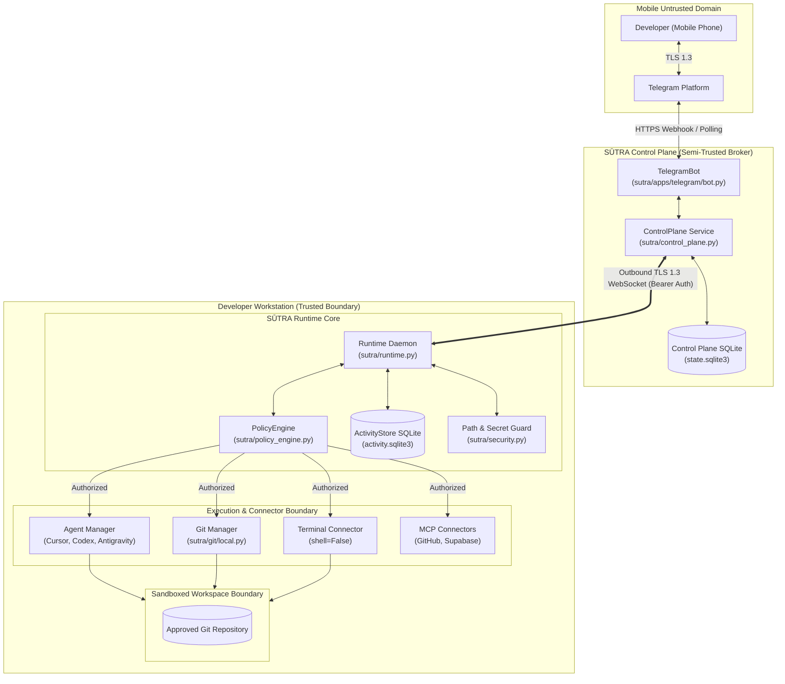
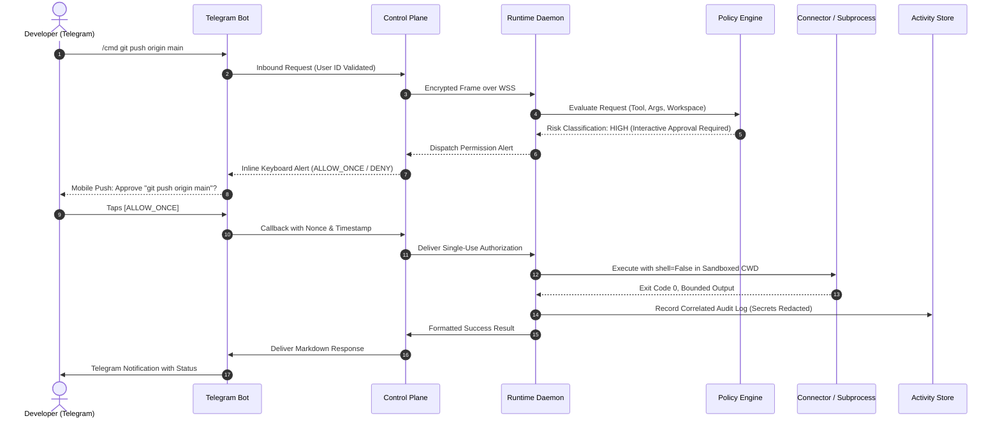

# SAMANVAYA · SŪTRA

> **File:** `README.md`  
> **Purpose:** Primary project overview, architecture introduction, verified capability matrix, quick start, and documentation navigation for the SŪTRA control plane.  
> **Audience:** Developers, security evaluators, contributors, and operators.  
> **Status:** Maintained — Verified against the SŪTRA codebase baseline.  

```
   ███████╗██╗   ██╗████████╗██████╗  █████╗ 
   ██╔════╝██║   ██║╚══██╔══╝██╔══██╗██╔══██╗
   ███████╗██║   ██║   ██║   ██████╔╝███████║
   ╚════██║██║   ██║   ██║   ██╔══██╗██╔══██║
   ███████║╚██████╔╝   ██║   ██║  ██║██║  ██║
   ╚══════╝ ╚═════╝    ╚═╝   ╚═╝  ╚═╝╚═╝  ╚═╝
     S A M A N V A Y A   ·   S Ū T R A
   Deterministic Local Control Plane for Coding Agents
```

[](pyproject.toml)
[](pyproject.toml)
[](SECURITY.md)
[](docs/architecture/ai-architecture.md)

---

## Table of Contents

- [1. What is SŪTRA?](#1-what-is-sūtra)
- [2. Problem & Solution](#2-problem--solution)
- [3. Key Verified Capabilities](#3-key-verified-capabilities)
- [4. High-Level Architecture](#4-high-level-architecture)
- [5. End-to-End Execution Flow](#5-end-to-end-execution-flow)
- [6. Connector Ecosystem & Status](#6-connector-ecosystem--status)
- [7. Agent Adapters & AI Models](#7-agent-adapters--ai-models)
- [8. Quick Start](#8-quick-start)
- [9. Configuration & Credentials](#9-configuration--credentials)
- [10. Testing & Verification](#10-testing--verification)
- [11. Security & Trust Boundaries](#11-security--trust-boundaries)
- [12. Current Limitations & Scope](#12-current-limitations--scope)
- [13. Documentation Roadmap](#13-documentation-roadmap)
- [14. Contributing & License](#14-contributing--license)

---

## 1. What is SŪTRA?

**SAMANVAYA · SŪTRA** (historically known as *AgentBridge*) is a secure, local-first control plane that bridges mobile and remote communication interfaces with high-privilege coding agents operating on local developer workstations.

SŪTRA establishes a fundamental architectural invariant:

> **SŪTRA is the control plane. The coding agent is the coding intelligence.**

While autonomous coding agents (such as Google Antigravity, Cursor, OpenAI Codex, and Google Jules) reason over code and propose filesystem or terminal modifications, SŪTRA acts as the deterministic supervisor. It intercepts actions, verifies workspace containment, enforces four-tier risk policies, audits events into an immutable SQLite store, and gives developers mobile supervision through Telegram without ever streaming private source code to third-party cloud relays.

---

## 2. Problem & Solution

### The Problem
- **Remote Blindness:** Developers stepping away from their workstations lose visibility into long-running autonomous agent runs.
- **Uncontrolled Agent Execution:** Unsupervised coding agents can perform destructive file operations, run unvalidated shell commands, escape workspace boundaries, or enter runaway token loops.
- **Cloud Privacy Risks:** Cloud-hosted agent relay solutions require uploading private source code, environment secrets, and intellectual property to intermediary servers.

### The SŪTRA Solution
- **Data Sovereignty:** Private source code never leaves the developer's physical workstation.
- **Deterministic Sandboxing:** Canonical path normalization and recursive traversal stripping (4 passes) enforce strict workspace boundaries.
- **Human-in-the-Loop Authorization:** Risk-stratified operations (`LOW`, `MEDIUM`, `HIGH`, `CRITICAL`) require interactive approval via mobile push before execution.
- **Outbound-Only TLS 1.3 Tunnels:** Workstations initiate outbound WebSocket connections to the control plane, eliminating exposed inbound ports.
- **Automated Secret Redaction:** API keys, private keys, certificates, and `.env` files are blocked from Git staging and masked in logs/chat previews.

---

## 3. Key Verified Capabilities

| Capability | Module | Verification Status | Architectural Guarantee |
| :--- | :--- | :---: | :--- |
| **Workspace Sandboxing** | `sutra/security.py`<br>`sutra/discovery.py` | **Verified** (Unit & Integration) | Recursive traversal stripping, symlink resolution, canonical boundary confinement. |
| **Deterministic Policy Engine** | `sutra/policy_engine.py`<br>`sutra/permissions.py` | **Verified** (Unit & Integration) | 4-tier risk classification; `CRITICAL` operations strictly require double-confirmation and cannot be auto-approved. |
| **Local Runtime Daemon** | `sutra/runtime.py`<br>`sutra/state.py` | **Verified** (Unit & Integration) | Loopback status/pairing (default `127.0.0.1:8765`), persistent SQLite state, process lifecycle management. |
| **TLS Control Plane** | `sutra/control_plane.py` | **Verified** (E2E & TLS) | Loopback TLS control plane (`127.0.0.1:8766`), cryptographic pairing (300s TTL), replay attack protection. |
| **Telegram Mobile Bot** | `sutra/apps/telegram/`<br>`sutra/telegram_bot.py` | **Verified** (Mocked E2E) | Numeric user ID allowlisting (`TELEGRAM_ALLOWED_USER_IDS`), interactive keyboards, callback deduplication. |
| **Local Git Operations** | `sutra/git/local.py`<br>`sutra/git/security.py` | **Verified** (Unit & Integration) | Safe branch creation, status, diff, pre-staging secret filtering (`.env*`, `*.pem`, `*.key`). |
| **GitHub REST Integration** | `sutra/git/github.py` | **Verified** (Mocked & Unit) | Pull requests, CI status checking, reviews, rate-limit backoff. |
| **Guarded Terminal Connector** | `sutra/connectors/terminal/` | **Verified** (Mocked & Unit) | `shell=False` execution, argument tokenization, workspace confinement, forbidden command blacklisting. |
| **Model Context Protocol (MCP)** | `sutra/connectors/mcp/` | **Verified** (Unit & Test Servers) | Transport-agnostic core (`stdio` and streamable `http`), protocol negotiation, tool discovery, structured errors. |
| **GitHub MCP Connector** | `sutra/connectors/mcp/github.py` | **Verified** (Unit & Test Server) | Connects to GitHub Remote MCP endpoints; OS Keyring token storage. |
| **Supabase MCP Connector** | `sutra/connectors/mcp/supabase.py` | **Verified** (Unit & Test Server) | Project ref validation, OAuth token resolution, default read-only policy. |
| **Activity Store & Audit Trail** | `sutra/activity_store.py` | **Verified** (Unit & Integration) | Persistent SQLite activity logs, correlation IDs, isolated from core execution failure. |

---

## 4. High-Level Architecture



---

## 5. End-to-End Execution Flow

A typical operator request (e.g., executing a command or invoking a connector tool) traverses a verified 7-stage deterministic pipeline:



---

## 6. Connector Ecosystem & Status

SŪTRA features a formal Connector abstraction (`sutra/connectors/interface.py`) managed by a central registry (`ConnectorRegistry`).

| Connector ID | Type | Provider | Implementation | Operational Status |
| :--- | :---: | :---: | :--- | :---: |
| `terminal` | `TERMINAL` | Local OS | `sutra/connectors/terminal/connector.py` | **Implemented & Verified** |
| `github-mcp` | `MCP` | Remote HTTP | `sutra/connectors/mcp/github.py` | **Implemented & Verified** |
| `supabase-mcp` | `MCP` | Remote HTTP | `sutra/connectors/mcp/supabase.py` | **Implemented & Verified** |
| `local-git` | `GIT` | Local Git | `sutra/git/local.py` | **Implemented & Verified** |
| `github-rest` | `REST` | GitHub API | `sutra/git/github.py` | **Implemented & Verified** |
| `slack` | `BOT` | Slack API | `sutra/apps/slack/bot.py` | *Scaffolded (Planned)* |
| `discord` | `BOT` | Discord API | `sutra/apps/discord/bot.py` | *Scaffolded (Planned)* |

> [!NOTE]
> Slack and Discord implementations are scaffolds for future multi-bot support. They are **not** operational in the current MVP release.

---

## 7. Agent Adapters & AI Models

SŪTRA coordinates autonomous coding agents via structured adapters (`sutra/adapters.py` and `sutra/agents/`):

- **Google Antigravity:** Dispatches to the Antigravity CLI and Python SDK.
- **Cursor:** Integrates with the headless `agent -p` interface.
- **OpenAI Codex:** Interfaces with Codex CLI and OpenAI API models.
- **Google Jules:** Interfaces with the `@google/jules` CLI toolchain.
- **Generic CLI Adapter:** Flexible adapter wrapping any standard command-line agent tool.

### Local Open-Weight Models & Ollama
SŪTRA is designed to remain operational on modest developer hardware:
- Open-weight models (such as Google Gemma and Meta Llama) can be run locally via **Ollama** (`http://127.0.0.1:11434`).
- SŪTRA does not mandate costly cloud LLM tokens for local AST parsing or rule validation (e.g., Graphify knowledge graphs operate with zero API tokens).

---

## 8. Quick Start

### Prerequisites
- **Python:** 3.11 or newer (`python --version`)
- **Git:** Installed and available in your shell `PATH`
- **Operating System:** Windows 10/11, macOS 12+, or modern Linux (Ubuntu 22.04+)

### 1. Clone & Setup Virtual Environment
```bash
# Clone the repository
git clone https://github.com/Subhadip-Paul2006/NotForYou.git
cd NotForYou

# Create and activate an isolated virtual environment
python -m venv .venv

# Windows PowerShell:
.venv\Scripts\Activate.ps1

# Linux / macOS:
source .venv/bin/activate

# Install with development dependencies
python -m pip install -e ".[dev]"
```

### 2. Initialize Development State & TLS Certificates
```bash
# Generate development TLS certificates and initialize ~/.sutra
python -m sutra setup
```

### 3. Register an Approved Workspace
```bash
# Register your project workspace directory
python -m sutra workspace add d:\practice-file

# List registered workspaces
python -m sutra workspace list
```

### 4. Start the SŪTRA Local Runtime
```bash
# Launch the interactive terminal runtime
python -m sutra local
```

> [!TIP]
> For complete step-by-step setup instructions—including Telegram bot configuration, control plane deployment, and connector credentials—consult the authoritative [Setup Guide](SETUP.md).

---

## 9. Configuration & Credentials

SŪTRA loads configuration from environment variables, an optional `.env` file, and the OS Keyring.

| Variable Name | Required | Default | Purpose |
| :--- | :---: | :---: | :--- |
| `SUTRA_HOME` | No | `~/.sutra` | Root directory for SQLite databases, logs, and state. |
| `SUTRA_CONTROL_PLANE_URL` | No | `""` | WebSocket URL for the control plane (e.g., `wss://127.0.0.1:8766`). |
| `SUTRA_CONTROL_PLANE_TOKEN` | Yes (for CP) | `""` | Operator token ($\ge 32$ chars) protecting the control plane. |
| `SUTRA_TLS_CERTFILE` | Yes (for CP) | `""` | Path to the control-plane TLS certificate. |
| `SUTRA_TLS_KEYFILE` | Yes (for CP) | `""` | Path to the control-plane TLS private key. |
| `SUTRA_TELEGRAM_BOT_TOKEN` | Optional | `""` | Telegram Bot API token obtained from `@BotFather`. |
| `SUTRA_TELEGRAM_ALLOWED_USER_IDS` | Optional | `""` | Comma-separated list of numeric Telegram User IDs allowed to issue commands. |
| `GITHUB_PERSONAL_ACCESS_TOKEN` | Optional | `""` | Personal access token for GitHub REST & MCP connectors. |
| `SUPABASE_ACCESS_TOKEN` | Optional | `""` | Personal access token for the Supabase MCP connector. |

---

## 10. Testing & Verification

The SŪTRA test suite uses `pytest` and includes unit tests, component tests, mock servers, failure-injection tests, and end-to-end flows.

```bash
# Run the automated test suite
python -m pytest -q

# Run specific connector tests
python -m pytest tests/test_connectors.py tests/test_mcp_client.py tests/test_terminal_connector.py -v
```

**Baseline Test Status:** 806 passed, 2 skipped, 13 subtests passed.

---

## 11. Security & Trust Boundaries

SŪTRA adheres to strict defense-in-depth security principles:
1. **Zero Raw Shell Invocations:** Prohibits `os.system()` and `subprocess.Popen(shell=True)`.
2. **Canonical Path Sandboxing:** Resolves physical symlink targets before checking workspace containment.
3. **No Code in the Cloud:** The control plane relays encrypted control frames; private source code remains on the developer's workstation.
4. **Credential Isolation:** Credentials are stored in OS Keyring or guarded SQLite state with OS ACLs. Raw tokens are never logged or echoed to mobile chats.

For detailed security architecture and threat mitigations (TH-01 through TH-14), refer to [SECURITY.md](SECURITY.md).

---

## 12. Current Limitations & Scope

- **Loopback Default:** SŪTRA binds services to `127.0.0.1` by default. Exposing the control plane to public networks requires an external reverse proxy with valid TLS.
- **External Live Credentials:** Automated tests use isolated mock servers (`tests/mocks/mcp_stdio_test_server.py`, etc.). Live GitHub, Supabase, and Telegram operations require valid user credentials.
- **Scaffolded Integrations:** Slack and Discord are currently scaffolds and not production-ready.
- **OS Subprocess Sandbox:** SŪTRA validates arguments and working directories, but standard child processes share the user's OS permissions unless wrapped in OS containers.

---

## 13. Documentation Roadmap

- [SETUP.md](SETUP.md) — Comprehensive, beginner-friendly workstation installation and verification guide.
- [USAGE.md](USAGE.md) — Authoritative command and interaction reference for CLI and Telegram ChatOps.
- [PRD.md](PRD.md) — Formal Product Requirements Document defining goals, user personas, and acceptance criteria.
- [TRD.md](TRD.md) — Technical Requirements Document detailing architecture, data models, and protocols.
- [SECURITY.md](SECURITY.md) — Threat model, trust boundaries, and security invariants.
- [CODE_OF_CONDUCT.md](CODE_OF_CONDUCT.md) — Contributor Covenant community behavioral standards and pledge.
- [AI_INSTRUCTIONS.md](AI_INSTRUCTIONS.md) — Governing operational rules for AI coding agents.
- [AGENTS.md](AGENTS.md) — Graphify knowledge graph protocol and token-saving rules for coding agents.
- [docs/architecture/ai-architecture.md](docs/architecture/ai-architecture.md) — In-depth architectural blueprint and diagram catalogue.
- [docs/architecture/connectors.md](docs/architecture/connectors.md) — Comprehensive connector framework architecture.
- [docs/reference/integrations.md](docs/reference/integrations.md) — Connector and AI provider technical reference.

---

## 14. Contributing & License
 
SŪTRA is licensed under the MIT License. Contributions that preserve our security invariants, maintain test coverage, and uphold local data sovereignty are welcomed. Please review [CODE_OF_CONDUCT.md](CODE_OF_CONDUCT.md), [AI_INSTRUCTIONS.md](AI_INSTRUCTIONS.md), and [SECURITY.md](SECURITY.md) before submitting pull requests.
# Hacktoberfest-AOT

