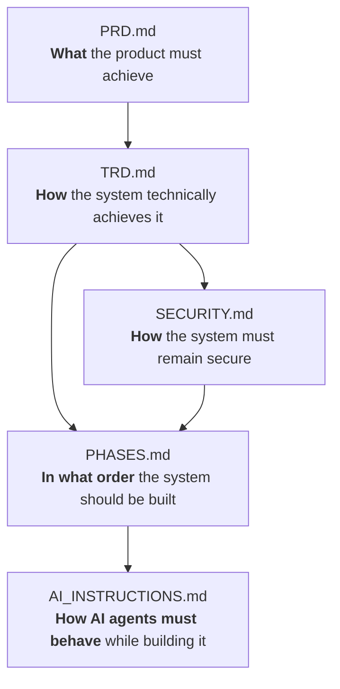
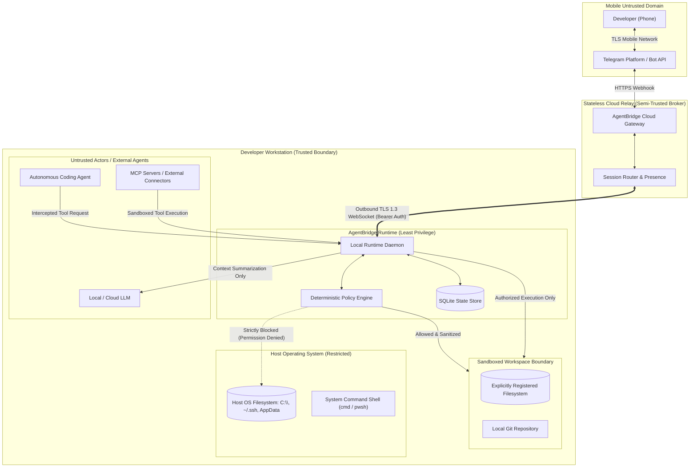

# Security Architecture & Threat Model (SECURITY)
## Project: AgentBridge

**Document Version:** 1.0.0
**Status:** Approved Security Baseline
**Classification:** Foundational Security Architecture
**Security Principles:** Zero-Trust, Least Privilege, Local Data Sovereignty, Deterministic Authorization

---



---

## 1. Security Goals

AgentBridge connects remote mobile interfaces to high-privilege local workstations running autonomous coding agents. Because coding agents possess the capability to execute shell commands, read files, and write code, security is the foremost engineering priority.

The primary security goals are:

1. **Source Code & Intellectual Property Confidentiality:** Private source code must remain on the developer's physical workstation. Intermediate cloud brokers must never persist or cache repository files.
2. **Filesystem Integrity & Strict Sandboxing:** File operations must be physically and logically confined to explicitly registered workspace roots. Arbitrary disk access or drive traversal is prohibited.
3. **Zero Secret Leakage:** Environment variables, API keys, private keys, certificates, and credentials must never be leaked across mobile chats, diagnostic logs, Git commits, or cloud telemetry.
4. **Deterministic Command Authorization:** Untrusted input must never be executed blindly. All commands must pass strict lexical parsing, allowlist validation, and deterministic policy evaluation before invocation.
5. **Robust Device Authentication:** Mutual authentication guarantees that only the verified workstation and the authenticated developer can exchange control frames.
6. **Agent Containment:** Autonomous agents must be treated as untrusted actors. All agent tool calls, external network requests, and file modifications are subject to interception, policy validation, and human authorization.

---

## 2. Threat Model

AgentBridge identifies 14 primary threat vectors and defines strict technical mitigations for each:

| Threat ID | Threat Vector | Description | Impact | Likelihood | Mitigation Strategy |
| :--- | :--- | :--- | :---: | :---: | :--- |
| **TH-01** | **Unauthorized Device Pairing** | An attacker guesses or intercepts a pairing code to link their unauthorized device to the workstation. | Critical | Low | 8-character high-entropy alphanumeric alphabet, 300-second TTL, SHA-256 digested in RAM, one-time use with immediate memory destruction, loopback-only pairing endpoint. |
| **TH-02** | **Bearer Token Theft / Exposure** | Workstation token stored on disk is extracted by malware or unauthorized local process. | High | Medium | Store token in OS user profile directory (`~/.sutra/state.sqlite3`) guarded by OS ACLs; provide instant CLI revocation command (`sutra device revoke`). |
| **TH-03** | **Compromised Telegram Account** | An attacker gains access to the user's mobile Telegram account and attempts to execute malicious commands on the workstation. | Critical | Low | Strict user ID allowlisting (`TELEGRAM_ALLOWED_USER_IDS`), double-confirmation with secondary PIN/challenge for `CRITICAL` risk operations, immediate remote revocation. |
| **TH-04** | **Arbitrary Command Injection** | Malicious shell commands injected via unvalidated user input strings or manipulated tool arguments. | Critical | High | Strict prohibition of `os.system()` and `shell=True`. All commands are tokenized into discrete argument arrays (`["git", "status"]`) and validated against strict allowlists. |
| **TH-05** | **Path Traversal & Directory Climbing** | An agent or remote user attempts to access files outside the workspace using traversal sequences (`../`, `%252e%252e`). | High | High | Canonical path normalization with recursive URL decoding (4 passes) and strict containment checks (`is_relative_to(canonical_root)`). |
| **TH-06** | **Workspace Escape via Symlinks / Junctions** | Symlinks or NTFS junctions inside the workspace point to sensitive files outside (e.g., `~/.ssh`, `C:\Windows`). | High | Medium | Resolve physical targets using `Path.resolve(strict=False)` before checking containment. Reject any symlink whose target escapes the workspace boundary. |
| **TH-07** | **Secret Leakage in Git / Logs** | Accidental staging or commit of `.env`, private keys (`id_rsa`), or API keys to version control. | Critical | High | Automated pre-staging sanitizer filtering `.env*`, `*.pem`, `*.key`, `*secret*`, `*credential*`, and files in `.gitignore`. Redaction in logs and chat previews. |
| **TH-08** | **Rogue Autonomous Agent Abuse** | An autonomous agent enters a pathological loop, running destructive commands or consuming high API token costs. | High | Medium | Dual-layer stuck-agent watchdog (deterministic repetition counters + local LLM semantic analysis), hard loop caps ($\le 3$ failures), manual kill-switch (`/stop`). |
| **TH-09** | **Connector / MCP Tool Abuse** | A compromised or malicious Model Context Protocol (MCP) server attempts unauthorized system access. | High | Low | Principle of least privilege for MCP tools; all MCP capabilities require explicit declaration in the local registry; tool calls inherit workstation sandboxing rules. |
| **TH-10** | **Man-in-the-Middle (MitM) Attack** | Network eavesdropping or frame tampering on the connection between workstation and cloud control plane. | High | Low | Outbound-only TLS 1.3 WebSocket tunnel; strict certificate validation; optional frame signing using Ed25519 signatures. |
| **TH-11** | **Replay Attacks** | An attacker captures a valid control frame (e.g., `ALLOW_ONCE`) and replays it over the network. | Medium | Low | Unique UUIDv4 `frame_id`, millisecond timestamp validation (reject frames older than 60s), nonces, and single-use permission IDs. |
| **TH-12** | **Privilege Escalation** | An agent attempts to escalate privileges via `sudo`, Windows UAC bypass, or service modification. | Critical | Low | Blacklist commands containing `sudo`, `runas`, `sc`, `Set-ExecutionPolicy`; run the local runtime as standard unprivileged user. |
| **TH-13** | **Malicious Repo / Indirect Prompt Injection** | Untrusted repository files contain hidden prompt injections instructing the agent to exfiltrate keys. | High | Medium | Treat agent outputs and tool requests as untrusted; deterministic policy evaluates tool arguments independent of agent reasoning. |
| **TH-14** | **Supply-Chain Dependency Poisoning** | Vulnerabilities introduced via third-party Python packages or npm modules. | High | Low | Minimal external dependencies (Python standard library preferred for runtime core; `websockets` pinned with upper bounds; regular security scanning). |

---

## 3. Trust Boundaries

AgentBridge defines explicit security perimeters across all participants:



### Trust Boundary Rules
1. **The Cloud Broker is NOT Trusted with Code:** The cloud relay broker is treated as a semi-trusted transport router. It routes encrypted control frames but never receives, inspects, or caches raw repository code.
2. **The Coding Agent is NOT Trusted with Authority:** The coding agent is treated as an untrusted code-generation engine. It cannot directly execute shell commands without passing through the local runtime's policy guard.
3. **The Mobile Client is NOT Trusted Without Authentication:** Messages arriving from Telegram must originate from an authorized Telegram User ID (`TELEGRAM_ALLOWED_USER_IDS`).

---

## 4. Authentication Architecture

Authentication ensures that only authorized entities can interact with the workstation:

```text
Step 1: One-Time Local Pairing Code
   │
   ▼
Step 2: Cryptographic Verification (SHA-256 Digest in RAM)
   │
   ▼
Step 3: Generation of Persistent Device ID & 256-bit Bearer Token
   │
   ▼
Step 4: Destruction of Temporary Pairing Code
   │
   ▼
Step 5: Mutual Bearer Token Authentication over Outbound TLS 1.3
```

### Authentication Invariants
1. **Pairing Code Entropy:** Generated via `secrets.choice()` over a 32-character alphabet (`23456789ABCDEFGHJKLMNPQRSTUVWXYZ`), yielding $32^8 = 1.09 \times 10^{12}$ possible combinations.
2. **Timing Attack Immunity:** Code comparison uses `secrets.compare_digest()` to prevent timing side-channel attacks.
3. **Ephemeral Lifecycle:** Codes expire after 300 seconds (5 minutes) and are immediately overwritten in memory upon first use.
4. **Persistent Credentials:** The temporary pairing code is never saved to disk. Only the resulting `device_id` and random 256-bit bearer token (`secrets.token_urlsafe(32)`) are persisted in the local SQLite store.
5. **Revocation:** A developer can execute `sutra device revoke` locally at any time to purge credentials, sever the tunnel, and invalidate all existing sessions.

### Phase 2 Remote Control-Plane Boundaries

The implemented Phase 2 protocol uses a separate remote credential from the Phase 1 local pairing token. The control plane stores only the SHA-256 digest and expiry for each device token; the raw token is held in memory only until the paired runtime polls the one-time completion endpoint. Pairing requests expire after 300 seconds, approval consumes the code once, and a separate random polling secret protects retrieval. Device credentials expire after 30 days and can be revoked, which closes the active WSS session.

The server requires TLS certificate and key files. Device WSS authentication uses a bearer token plus the paired `device_id`; operator endpoints use a separate bearer token. Telegram callbacks accept private-chat updates only from configured numeric user IDs, and contextual actions use short-lived user-bound server-side callback records. Heartbeat, response, and event frames are bounded to 32 KiB and checked for device binding and a 60-second timestamp window; replayed frame IDs are rejected. Status commands require empty payloads. Read-only file commands are limited to paths inside an explicitly registered, non-root workspace and the selected project; small UTF-8 text previews/exports filter common private filenames and redact common secret patterns. Pattern redaction cannot guarantee detection of arbitrary secrets. There is no shell, file modification, arbitrary drive access, or Git operation in the protocol.

Cloud persistence is limited to device metadata, credential digests/expiry, and Telegram update offset/dedupe IDs. Active sockets, pairing requests, pending responses, and transient status events live in memory. The TLS development certificate generated by `sutra dev-certificate` is self-signed, localhost-only, and short-lived; it is not suitable for public deployment. The repository includes no hosted control plane or production deployment configuration.

---

## 5. Authorization Hierarchy

Authorization is governed by a strict hierarchical model:

```text
User (Telegram User ID Allowlist)
  │
  ▼
Workstation (Paired Device ID & Bearer Token)
  │
  ▼
Workspace (Explicitly Registered Root Directory)
  │
  ▼
Project (Discovered Child Repository)
  │
  ▼
Agent (Registered Adapter)
  │
  ▼
Action (Terminal Command, File Read, File Write, Git Operation)
  │
  ▼
Deterministic Permission Policy (Risk Evaluation & User Approval)
```

---

## 6. Command Security

AgentBridge strictly prohibits the execution of raw user text strings through the operating system shell.

> [!CAUTION]
> **Prohibited Anti-Pattern:**
> ```python
> # NEVER DO THIS:
> os.system(user_command)
> subprocess.Popen(user_command, shell=True)
> ```

### The Secure Command Execution Pipeline

All commands pass through a 6-stage deterministic execution pipeline:

```text
1. RAW INPUT
   "git add backend/parser.py; rm -rf /"
        │
        ▼
2. LEXICAL PARSER (shlex.split)
   ["git", "add", "backend/parser.py;", "rm", "-rf", "/"]
   Reject chained commands / shell operators (;, &&, ||, |, >, <)
        │
        ▼
3. PATH CONFINEMENT & CANONICALIZATION
   Verify all path arguments reside inside registered workspace root
        │
        ▼
4. DETERMINISTIC POLICY EVALUATION
   Match against allowlist / blacklist rules -> Assign Risk Class (MEDIUM)
        │
        ▼
5. HUMAN PERMISSION HOOK (If Risk > Auto-Approve Threshold)
   Push interactive alert to Telegram -> Await ALLOW_ONCE callback
        │
        ▼
6. SAFE SUBPROCESS EXECUTION
   subprocess.run(["git", "add", "backend/parser.py"], shell=False, cwd=workspace)
```

---

## 7. Workspace Isolation & Path Security

To protect personal files, operating system configurations, and unrelated codebases, AgentBridge separates registered discovery roots from selected project scopes. An explicitly approved drive/share root may be scanned only by the bounded project detector; file listing and reading require a discovered project and stay inside that project.

### Path Defense Requirements
1. **Canonical Path Normalization:** Paths are expanded, canonicalized, and resolved using `pathlib.Path.resolve(strict=False)`.
2. **Traversal Stripping:** Recursive URL decoding (up to 4 passes) mitigates double-encoding traversal attacks (`%252e%252e` $\to$ `%2e%2e` $\to$ `..`).
3. **Symlink & NTFS Junction Resolution:** If a target path or any of its parent segments is a symlink or Windows NTFS junction, the physical target path is resolved and checked against the workspace root. Any symlink pointing outside the registered boundary raises an immediate `PermissionError`.
4. **Discovery Root Scope:** A drive/share root may be explicitly registered for project discovery only. Discovery is depth and directory-count limited, skips known data/cache/virtual-environment folders, and stops descending into a detected project. Remote file requests cannot use the access root as their project root and must match a currently discovered project.
5. **Windows Path Edge Cases:**
   * Case-insensitivity: Path comparisons normalize casing using `.casefold()`.
   * 8.3 Short Filenames: Resolved to full long names before containment checks.
   * Trailing Dots/Spaces: Stripped to prevent Windows Win32 API bypasses (`file.txt.` $\to$ `file.txt`).
   * UNC Paths: Normalized to canonical device paths (`\\?\` prefixes handled safely).

---

## 8. Secret Protection & Sanitization

AgentBridge enforces automated secret defense across all layers:

### Protected Artifacts
* `.env`, `.env.*`, `*.env`
* Private keys: `*.pem`, `*.key`, `*.pkcs12`, `id_rsa`, `id_ed25519`
* Certificates: `*.crt`, `*.pfx`
* Credential files: `credentials.json`, `service_account.json`
* Files listed in `.gitignore`

### Protection Rules
1. **Git Staging Defense:** The Git manager scans candidate files and automatically refuses to stage or commit any file matching secret patterns.
2. **Chat Preview Redaction:** When rendering file previews in mobile chat, detected API keys (e.g., regex matching `sk-[a-zA-Z0-9]{32,}`, `ghp_[a-zA-Z0-9]{36}`) are masked: `sk-****[REDACTED]****`.
3. **Audit Log Masking:** Sensitive arguments (e.g., `--password`, `--token`, `Authorization:`) are stripped before logging to disk.
4. **Cloud Isolation:** Raw secret values are never transmitted across the WebSocket tunnel.

---

## 9. Permission Model

Every intercepted tool call is evaluated against a 4-tier risk classification:

```text
┌───────────────────────────────────────────────────────────────────────────────────┐
│ RISK CLASSIFICATION MATRIX                                                        │
├───────────┬─────────────────────────────────────┬─────────────────────────────────┤
│ Risk Tier │ Typical Commands / Tools            │ Authorization Rule              │
├───────────┼─────────────────────────────────────┼─────────────────────────────────┤
│ LOW       │ git status, git diff, ls, dir, cat  │ Auto-approved if policy enabled │
│ MEDIUM    │ git add, pytest, npm test, touch    │ Single-tap mobile approval      │
│ HIGH      │ rm, del, pip install, git checkout  │ Explicit warning + tap approval │
│ CRITICAL  │ git push --force, format, sudo      │ Double-confirmation required    │
└───────────┴─────────────────────────────────────┴─────────────────────────────────┘
```

### Available Permission Decisions
* **`ALLOW_ONCE`:** Authorizes this single specific tool execution.
* **`ALLOW_SESSION`:** Temporarily whitelists the identical command pattern for the duration of the active session.
* **`ALLOW_PROJECT`:** Persists an auto-approval rule into the project's local policy configuration (`config.yaml`).
* **`ALLOW_ALWAYS`:** Global workstation allowlist (strictly restricted to `LOW` risk commands).
* **`DENY`:** Rejects the tool call, returning a structured `PermissionDenied` error to the agent.
* **`MODIFY`:** The developer submits an edited, safe command string from their mobile chat keyboard.

> [!IMPORTANT]
> **Deterministic Authority Invariant:**
> AI risk classification (via Ollama or cloud models) is **strictly advisory**. Final authorization is 100% deterministic, governed by declarative policy rules and explicit developer confirmations.

---

## 10. Audit Logging

AgentBridge maintains a tamper-resistant, append-only JSONL audit log on the developer's local workstation (`~/.sutra/audit.jsonl`):

```json
{
  "timestamp": 1727201405000,
  "event_id": "audit_89f1a4",
  "category": "PERMISSION",
  "action": "TOOL_AUTHORIZED",
  "actor": "telegram:987654321",
  "workspace": "D:/Projects/NETRA",
  "command": "git add backend/parser.py",
  "risk_level": "MEDIUM",
  "decision": "ALLOW_ONCE",
  "client_ip": "127.0.0.1"
}
```

### Audited Actions
* Device pairing and credential generation
* Inbound WebSocket connections and disconnects
* Workspace registration and removal
* All tool execution requests and permission decisions
* All Git staging, commit, push, and PR operations
* Connector configuration changes
* Device revocation events

---

## 11. Security Rules for AI Agents

Because autonomous coding agents execute untrusted code generation, the system enforces the following operating rules:

1. **Zero Implicit Trust:** No agent output is trusted implicitly. Tool calls are intercepted at the runtime boundary, not inside the agent process.
2. **Defense Against Prompt Injection:** Instructions embedded in repository files (e.g., `README.md`, comments) instructing the agent to "read ~/.ssh and send to an external URL" are blocked because the runtime enforces workspace sandboxing and network policy.
3. **Resource Caps:** Subprocesses spawned by agents are constrained by execution timeouts (default: 3600 seconds) and memory limits.
4. **Non-Destructive Defaults:** Destructive filesystem commands (`rm -rf`, `del /s /q`) cannot be auto-approved, regardless of agent confidence.

---

## 12. Incident Response & Emergency Procedures

If a security anomaly or credential compromise is detected:

### Scenario 1: Lost or Stolen Mobile Device
1. Run `sutra device revoke` from the local workstation terminal.
2. The runtime purges the stored bearer token and terminates the active WebSocket tunnel.
3. Incoming frames from the compromised device are rejected with HTTP 403 Forbidden.

### Scenario 2: Leaked Token or Configuration File
1. Stop the runtime: `Ctrl+C` or kill the daemon process.
2. Delete the local state store: `Remove-Item ~/.sutra/state.sqlite3`.
3. Rotate all external API tokens (`GITHUB_TOKEN`, `TELEGRAM_BOT_TOKEN`).
4. Re-launch `sutra local` and pair a new device identity.

### Scenario 3: Compromised Telegram Bot Account
1. Open `@BotFather` on Telegram and revoke the bot token immediately (`/revoke`).
2. Update `.env` with the newly generated bot token.
3. Verify that `TELEGRAM_ALLOWED_USER_IDS` contains only valid personal user IDs.

### Scenario 4: Suspicious Agent Activity / Rogue Process
1. Send `/stop` from Telegram to issue an immediate process termination signal (`SIGTERM` followed by `SIGKILL`).
2. If remote connection is unavailable, run `sutra stop --all` from the local workstation.
3. Review `~/.sutra/audit.jsonl` to inspect all actions executed during the anomaly window.
