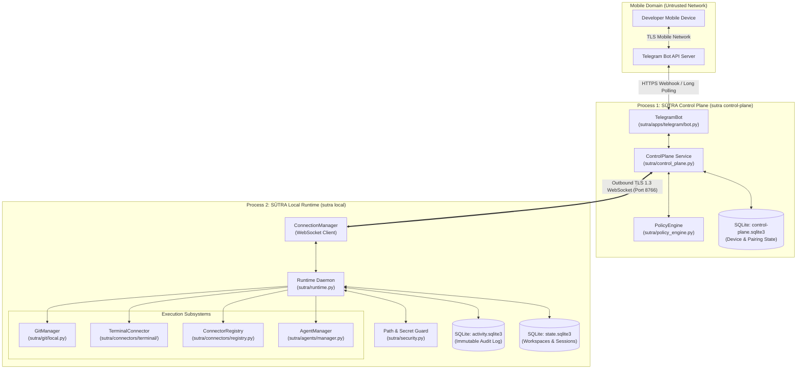
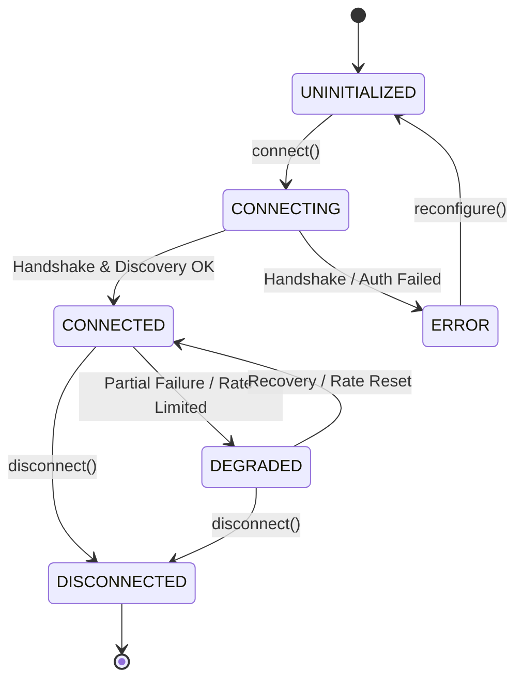
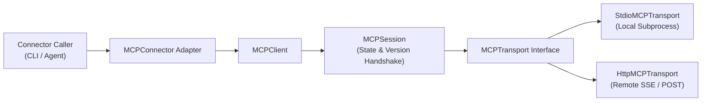
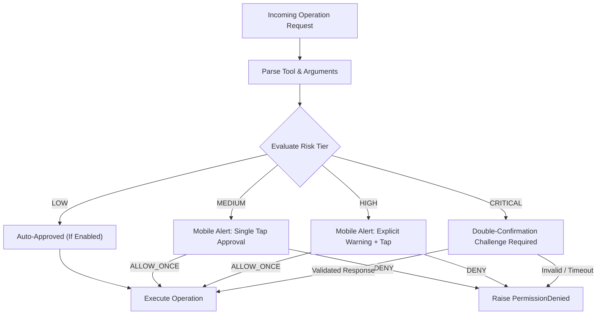

# Technical Requirements Document (TRD) — SAMANVAYA · SŪTRA

> **File:** `TRD.md`  
> **Purpose:** Document the system architecture, component contracts, protocol specifications, data models, and implementation details for SŪTRA.  
> **Audience:** Core engineers, system architects, security auditors, and technical contributors.  
> **Status:** Approved Technical Baseline — Source-verified against `sutra` package implementation.  

---

## Table of Contents

- [1. Architectural Overview](#1-architectural-overview)
- [2. Verified Technology Stack](#2-verified-technology-stack)
- [3. System Topology & Process Boundaries](#3-system-topology--process-boundaries)
- [4. Module & Package Organization](#4-module--package-organization)
- [5. Runtime & Control-Plane Protocol](#5-runtime--control-plane-protocol)
- [6. Connector Architecture & Lifecycle](#6-connector-architecture--lifecycle)
- [7. Model Context Protocol (MCP) Infrastructure](#7-model-context-protocol-mcp-infrastructure)
- [8. GitHub Integration Architecture: REST vs. MCP](#8-github-integration-architecture-rest-vs-mcp)
- [9. Guarded Terminal Execution Pipeline](#9-guarded-terminal-execution-pipeline)
- [10. Supabase MCP Connector Architecture](#10-supabase-mcp-connector-architecture)
- [11. Deterministic Policy Engine & Permissions](#11-deterministic-policy-engine--permissions)
- [12. ActivityStore, Auditing & Secret Redaction](#12-activitystore-auditing--secret-redaction)
- [13. Persistence Architecture & SQLite Schemas](#13-persistence-architecture--sqlite-schemas)
- [14. Configuration Management & Credential Precedence](#14-configuration-management--credential-precedence)
- [15. Network Resilience, Timeouts & Error Normalization](#15-network-resilience-timeouts--error-normalization)
- [16. Resource Bounding & Cross-Platform Engine](#16-resource-bounding--cross-platform-engine)
- [17. Verification Strategy & Test Architecture](#17-verification-strategy--test-architecture)
- [18. Known Technical Debt & Architecture Boundaries](#18-known-technical-debt--architecture-boundaries)
- [19. Implementation References](#19-implementation-references)

---

## 1. Architectural Overview

**SAMANVAYA · SŪTRA** is a local-first, defense-in-depth control plane engineered to supervise high-privilege coding agents operating on developer workstations.

### Core Architectural Invariant
```text
┌──────────────────────────────────────────────────────────────────────────────┐
│ SŪTRA ARCHITECTURAL INVARIANT                                                │
│ "SŪTRA is the control plane. The coding agent is the coding intelligence."   │
│                                                                              │
│ 1. All agent actions (terminal, filesystem, network) MUST be intercepted.    │
│ 2. Policy decisions are deterministic, rule-based, and human-verified.       │
│ 3. Private source code NEVER leaves the physical host machine.               │
└──────────────────────────────────────────────────────────────────────────────┘
```

The system splits responsibilities into two distinct software layers:
1. **The SŪTRA Local Runtime (`sutra.runtime.Runtime`):** Runs on the developer's physical workstation with direct access to registered project repositories and local execution tools.
2. **The SŪTRA Control Plane (`sutra.control_plane.ControlPlane`):** Manages mobile client communication (via Telegram), coordinates operator pairing, evaluates multi-tier permission policies, and proxies encrypted control frames to the runtime over an outbound TLS 1.3 WebSocket tunnel.

---

## 2. Verified Technology Stack

| Layer | Technology | Version Constraint | Justification |
| :--- | :--- | :--- | :--- |
| **Language Runtime** | Python | `>= 3.11` | Type hinting improvements, `asyncio` task groups, `pathlib.Path.is_relative_to()`. |
| **HTTP & WebSockets** | FastAPI / Uvicorn | `fastapi >= 0.115`, `uvicorn >= 0.30` | High-performance async ASGI server for local control plane. |
| **WebSocket Transport**| websockets | `>= 14.0, < 16.0` | RFC 6455 compliant client/server WebSocket communication. |
| **HTTP Client** | HTTPX | `>= 0.27, < 1.0` | Async HTTP/1.1 and HTTP/2 client for GitHub REST and MCP streaming HTTP. |
| **Credential Storage** | Keyring | `>= 24.0` | Secure integration with native OS credential stores (Windows Credential Manager, macOS Keychain, Secret Service). |
| **Terminal UI** | Rich | `>= 13.0.0, < 14.0` | Modern ANSI-styled terminal logging, animated startup panels, and status tables. |
| **Environment Config** | python-dotenv | `>= 1.0, < 2.0` | Non-destructive `.env` configuration file loader. |
| **State Persistence** | SQLite 3 | Standard Library | Local zero-dependency ACID-compliant relational storage with WAL mode. |
| **Testing** | pytest | `>= 8.0` | Full automated test suite (unit, component, and mock server suites). |

---

## 3. System Topology & Process Boundaries



---

## 4. Module & Package Organization

```text
sutra/
├── __init__.py                 # Package version and export definitions
├── __main__.py                 # CLI entry point wrapper
├── cli.py                      # Main CLI commands (local, control-plane, setup, connectors)
├── runtime.py                  # Core local workstation runtime daemon
├── control_plane.py            # Local TLS control-plane service and WebSocket router
├── policy_engine.py            # Deterministic policy evaluation engine
├── permissions.py              # Permission rules, risk classification, decision enums
├── activity_store.py           # Immutable SQLite audit trail with secret redaction
├── security.py                 # Path containment, traversal stripping, and sanitization
├── state.py                    # Workstation state store (workspaces, devices, pairing)
├── discovery.py                # Bounded workspace project discovery
├── dev_certificate.py          # Localhost development TLS certificate generator
├── credentials.py              # Portable OS Keyring and environment credential providers
├── apps/
│   ├── common/                 # Bot app abstractions and registry
│   └── telegram/               # Telegram bot handlers, keyboards, callbacks, formatting
├── git/
│   ├── local.py                # Local Git operations (status, diff, branch, stage)
│   ├── github.py               # GitHub REST API client (PRs, issues, CI checks)
│   ├── security.py             # Git pre-staging secret filtering
│   └── resilience.py           # Git retry, backoff, and network recovery
└── connectors/
    ├── interface.py            # Canonical Connector base class and contracts
    ├── registry.py             # Central connector registry and lifecycle coordinator
    ├── models.py               # Typed request, result, and descriptor data models
    ├── errors.py               # Structured connector error hierarchy
    ├── cli.py                  # Connector CLI handler (add, auth, test, status, tools)
    ├── terminal/               # Guarded local command execution connector
    └── mcp/                    # Transport-agnostic Model Context Protocol client core
        ├── transport.py        # Abstract MCPTransport contract
        ├── stdio.py            # Subprocess-based stdio transport
        ├── http.py             # Streaming HTTP transport (JSON-RPC 2.0 / SSE)
        ├── session.py          # Protocol handshake and state coordinator
        ├── client.py           # High-level MCP client (tools, resources, prompts)
        ├── connector.py        # Generic MCPConnector adapter
        ├── github.py           # Dedicated GitHub Remote MCP connector
        └── supabase.py         # Dedicated Supabase Remote MCP connector
```

---

## 5. Runtime & Control-Plane Protocol

Communication between the local runtime and the control plane uses an outbound-only WebSocket connection with typed JSON-RPC-style frames.

### Frame Specification
Every WebSocket frame MUST conform to the schema:
```json
{
  "frame_id": "c4b3a1d2-5e6f-7a8b-9c0d-1e2f3a4b5c6d",
  "timestamp": 1776078000123,
  "device_id": "dev_7f8a9b0c",
  "type": "command_request",
  "payload": {
    "action": "git_status",
    "project_path": "d:/practice-file",
    "params": {}
  }
}
```

### Protocol Invariants
1. **Frame Bounding:** Maximum frame size is strictly capped at `32 KiB` (`32768 bytes`) to prevent memory exhaustion attacks.
2. **Freshness Window:** Frames with timestamps older than `60 seconds` relative to the receiving clock are rejected.
3. **Replay Defense:** The control plane caches `frame_id` values in memory; duplicated IDs are immediately dropped.
4. **Mutual Authentication:** Runtimes must supply a valid `device_id` and pre-shared 256-bit bearer token during the WebSocket handshake (`Authorization: Bearer <token>`).

---

## 6. Connector Architecture & Lifecycle

All integrations conform to the `Connector` abstract base class (`sutra/connectors/interface.py`).

### Connector Lifecycle State Machine



### Connector Contracts
- `initialize(config: ConnectorConfig) -> None`
- `connect() -> None`
- `disconnect() -> None`
- `health_check() -> ConnectorHealth`
- `execute_operation(request: ConnectorRequest) -> ConnectorResult`
- `list_capabilities() -> list[ConnectorCapability]`

---

## 7. Model Context Protocol (MCP) Infrastructure

SŪTRA implements the Anthropic Model Context Protocol (MCP) as a first-class, transport-agnostic client subsystem.



### Protocol Version Negotiation
`MCPSession` negotiates the highest mutually supported protocol version during initialization:
- `2026-07-28` (Current Standard)
- `2024-11-05` (Legacy Fallback)

---

## 8. GitHub Integration Architecture: REST vs. MCP

SŪTRA provides two distinct GitHub integration pathways:

| Dimension | GitHub REST Integration (`sutra/git/github.py`) | GitHub MCP Connector (`sutra/connectors/mcp/github.py`) |
| :--- | :--- | :--- |
| **Protocol** | Direct HTTPS REST API (`api.github.com`) | Streamable HTTP MCP (`api.githubcopilot.com/mcp/`) |
| **Transport** | `httpx.AsyncClient` | `HttpMCPTransport` (JSON-RPC 2.0 over HTTP) |
| **Use Cases** | Direct PR creation, issue inspection, Git remote synchronization, CI/Actions polling | Semantic coding tools discovered dynamically by autonomous agents |
| **Authentication** | `GITHUB_TOKEN` environment variable or parameter | OS Keyring or `GITHUB_PERSONAL_ACCESS_TOKEN` |
| **Tool Execution** | Statically defined method calls | Dynamic tool discovery (`tools/list` and `tools/call`) |
| **Permissioning** | Evaluated at the command level | Evaluated per tool call via `PolicyEngine` |

---

## 9. Guarded Terminal Execution Pipeline

The Terminal Connector (`sutra/connectors/terminal/`) provides strictly contained local shell command execution.

### Security Invariants
1. **No Shell Execution:** `os.system()` and `subprocess.Popen(shell=True)` are strictly prohibited.
2. **Lexical Tokenization:** Commands are tokenized via `shlex.split(command, posix=True)`.
3. **Operator Blacklist:** Any command containing shell operators (`;`, `&&`, `||`, `|`, `>`, `<`, `$(`, `` ` ``) is rejected before process creation.
4. **Workspace Confinement:** Child processes are spawned with `cwd=workspace_root`.
5. **Environment Scrubbing:** The child process environment inherits system paths but explicitly strips known secret variables (`GITHUB_TOKEN`, `SUPABASE_KEY`, etc.).

---

## 10. Supabase MCP Connector Architecture

The Supabase MCP Connector (`sutra/connectors/mcp/supabase.py`) enables autonomous agents to inspect database schemas, execute queries, and inspect migrations.

### Architecture Details
- **Project Ref Validation:** Enforces strict regex validation (`^[a-z0-9]{20}$`) to prevent header or URL injection.
- **Credential Resolution:** Priority order: OS Keyring (`service="sutra-connector-supabase"`) $\to$ `SUPABASE_ACCESS_TOKEN` $\to$ interactive prompt.
- **Default Read-Only Policy:** By default, all mutating operations (table drops, deletes, schema alterations) are classified as `CRITICAL` risk and blocked without double-confirmation.

---

## 11. Deterministic Policy Engine & Permissions

Every operation passing through SŪTRA is evaluated by the `PolicyEngine` against four risk tiers:



### Safety Invariant
> **CRITICAL operations can NEVER be persisted into `ALLOW_ALWAYS` or auto-approved.**

---

## 12. ActivityStore, Auditing & Secret Redaction

The ActivityStore (`sutra/activity_store.py`) maintains an immutable, queryable audit log in SQLite (`~/.sutra/activity.sqlite3`).

### Secret Redaction Engine
Before writing to SQLite or returning outputs to Telegram, strings pass through `sutra/redaction.py`:
- GitHub Tokens: `ghp_[A-Za-z0-9]{36}` $\to$ `ghp_****[REDACTED]****`
- OpenAI / API Keys: `sk-[A-Za-z0-9]{32,}` $\to$ `sk-****[REDACTED]****`
- Bearer Headers: `Bearer\s+[A-Za-z0-9._~+/-]+` $\to$ `Bearer [REDACTED]`
- Private Keys: `-----BEGIN [A-Z ]+ PRIVATE KEY-----` $\to$ `[REDACTED PRIVATE KEY]`

---

## 13. Persistence Architecture & SQLite Schemas

SŪTRA utilizes SQLite with write-ahead logging (`PRAGMA journal_mode=WAL;`) and a busy timeout of 5000ms (`PRAGMA busy_timeout=5000;`).

### 1. Workstation State Store (`~/.sutra/state.sqlite3`)
- `workspaces`: Registered workspace directory paths and timestamps.
- `devices`: Paired device IDs, public keys, and bearer token hashes.
- `sessions`: Active agent session identifiers and states.

### 2. Activity Store (`~/.sutra/activity.sqlite3`)
- `activities`: Timestamp, operation ID, correlation ID, connector ID, action, risk class, decision, duration ms, status, error message, and redacted metadata.

---

## 14. Configuration Management & Credential Precedence

Configuration values are resolved using strict precedence:
1. Explicit CLI arguments (highest priority)
2. Operating System environment variables (`os.environ`)
3. Local `.env` file (loaded via `python-dotenv` with `override=False`)
4. OS Keyring (`keyring` service)
5. Built-in defaults (lowest priority)

---

## 15. Network Resilience, Timeouts & Error Normalization

### Timeout Standards
- HTTP Connection Timeout: `10 seconds`
- HTTP Read/Write Timeout: `30 seconds`
- MCP Stdio Process Timeout: `60 seconds`
- Control-Plane Heartbeat Ping Interval: `30 seconds`

### Exponential Backoff
Failed outbound network requests follow bounded exponential backoff:
$$T_{\text{wait}} = \min(T_{\text{max}}, T_{\text{base}} \times 2^{\text{attempt}}) \pm \text{jitter}$$
where $T_{\text{base}} = 2\text{s}$, $T_{\text{max}} = 30\text{s}$, and jitter is randomly distributed $\pm 10\%$.

---

## 16. Resource Bounding & Cross-Platform Engine

- **File Previews:** Bounded to 50KB chunks to prevent mobile chat buffer overflow.
- **Directory Discovery:** Bounded to a maximum search depth of 4 levels, automatically skipping `.git`, `node_modules`, `.venv`, and `__pycache__`.
- **Platform Independence:** Path handling strictly uses `pathlib.Path` to normalize forward/backward slashes and UNC prefixes across Windows and POSIX systems.

---

## 17. Verification Strategy & Test Architecture

The repository enforces strict test quality:
- **Unit Tests:** Validate pure logic, lexical parsers, redaction regexes, and policy transitions.
- **Component Tests:** Test SQLite stores, Keyring credential providers, and transport wrappers.
- **Integration Tests:** Execute against isolated local test servers (`tests/mocks/mcp_stdio_test_server.py`, `tests/mocks/mcp_github_test_server.py`, `tests/mocks/mcp_supabase_test_server.py`).
- **Failure Injection Tests:** Simulate dropped connections, slow HTTP responses, truncated JSON frames, and database locks.

---

## 18. Known Technical Debt & Architecture Boundaries

1. **Localhost Binding Default:** Services bind to loopback addresses (`127.0.0.1`). Public deployment requires an external secure reverse proxy.
2. **Scaffolded Connectors:** Slack and Discord implementations are non-operational scaffolds reserved for future phases.
3. **Live Testing Separation:** Live GitHub and Supabase operations require user credentials and are tested separately from automated CI suites.

---

## 19. Implementation References

- Local Runtime: [`sutra/runtime.py`](file:///d:/practice-file/sutra/runtime.py)
- Control Plane: [`sutra/control_plane.py`](file:///d:/practice-file/sutra/control_plane.py)
- Policy Engine: [`sutra/policy_engine.py`](file:///d:/practice-file/sutra/policy_engine.py)
- Connector Framework: [`sutra/connectors/interface.py`](file:///d:/practice-file/sutra/connectors/interface.py)
- MCP Client Core: [`sutra/connectors/mcp/client.py`](file:///d:/practice-file/sutra/connectors/mcp/client.py)
- Activity Store: [`sutra/activity_store.py`](file:///d:/practice-file/sutra/activity_store.py)
- Architecture Blueprint: [`docs/architecture/ai-architecture.md`](file:///d:/practice-file/docs/architecture/ai-architecture.md)
