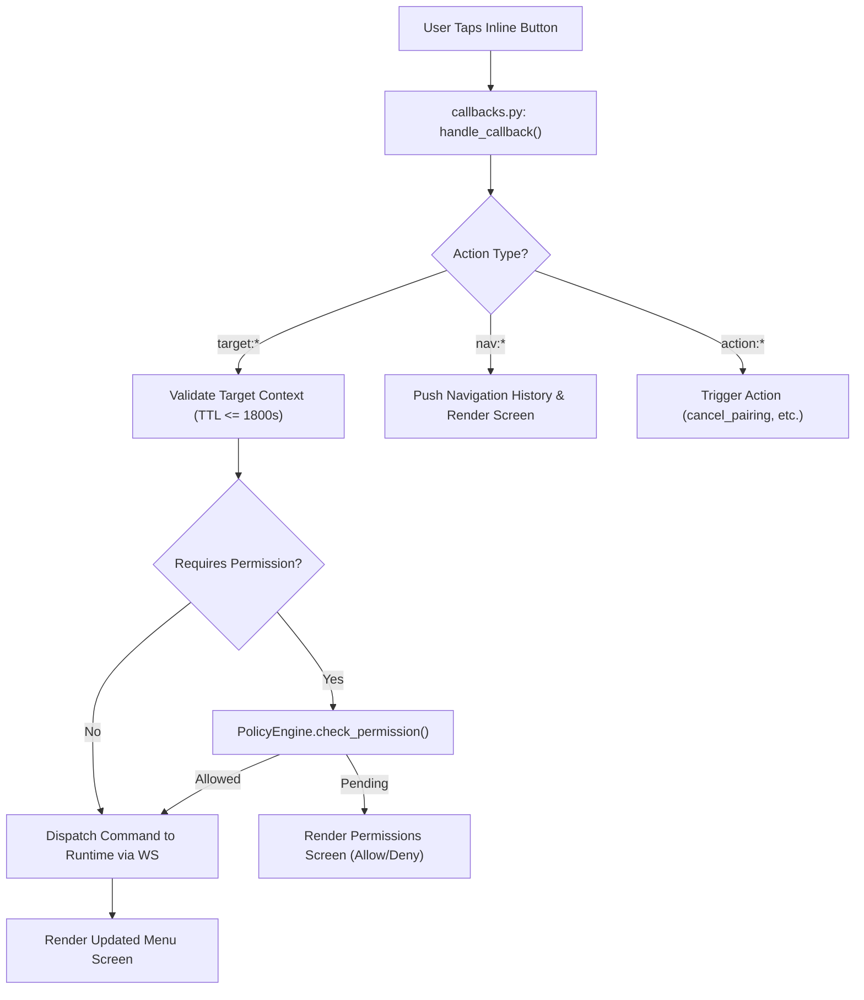

# AgentBridge Usage Guide — SAMANVAYA · SŪTRA

> **File:** `USAGE.md`  
> **Purpose:** Authoritative, source-verified operator and developer command reference for the Command-Line Interface (CLI) and Telegram ChatOps bot in SAMANVAYA · SŪTRA (AgentBridge).  
> **Audience:** Developers, operators, system administrators, and security reviewers.  
> **Status:** Active & Source-Verified against `sutra` package implementations.  

---

## Table of Contents

- [1. Overview and Prerequisites](#1-overview-and-prerequisites)
- [2. Starting and Stopping AgentBridge](#2-starting-and-stopping-agentbridge)
- [3. CLI Command Reference](#3-cli-command-reference)
  - [3.1 Global & Runtime Commands](#31-global--runtime-commands)
  - [3.2 Workspace & Project Management](#32-workspace--project-management)
  - [3.3 Diagnostics & Agent Inspection](#33-diagnostics--agent-inspection)
  - [3.4 Connector Management Subcommands](#34-connector-management-subcommands)
- [4. Telegram Bot Command Reference](#4-telegram-bot-command-reference)
  - [4.1 Core Session & Pairing Commands](#41-core-session--pairing-commands)
  - [4.2 Navigation & Inspection Commands](#42-navigation--inspection-commands)
  - [4.3 File & Code Navigation Commands](#43-file--code-navigation-commands)
  - [4.4 Git & GitHub ChatOps Commands](#44-git--github-chatops-commands)
- [5. Telegram Menus, Inline Buttons, and Callback Actions](#5-telegram-menus-inline-buttons-and-callback-actions)
  - [5.1 Persistent Reply Navigation Keyboard](#51-persistent-reply-navigation-keyboard)
  - [5.2 Interactive Screens Catalog](#52-interactive-screens-catalog)
  - [5.3 Button Callback Actions & Flow](#53-button-callback-actions--flow)
- [6. Workspace and File-Exploration Commands](#6-workspace-and-file-exploration-commands)
- [7. Local Git and GitHub REST Commands](#7-local-git-and-github-rest-commands)
- [8. GitHub MCP Connector Commands](#8-github-mcp-connector-commands)
- [9. Terminal Connector Commands](#9-terminal-connector-commands)
- [10. Supabase MCP Connector Commands](#10-supabase-mcp-connector-commands)
- [11. AI Provider and Local-Model Configuration Commands](#11-ai-provider-and-local-model-configuration-commands)
- [12. Permission and Policy-Management Commands](#12-permission-and-policy-management-commands)
- [13. Connector Lifecycle, Health, and Diagnostic Commands](#13-connector-lifecycle-health-and-diagnostic-commands)
- [14. Configuration and Troubleshooting](#14-configuration-and-troubleshooting)
- [15. Unsupported, Scaffolded, or Unverified Operations](#15-unsupported-scaffolded-or-unverified-operations)
- [16. Telegram vs CLI Command Comparison](#16-telegram-vs-cli-command-comparison)
- [17. Safe End-to-End Operational Workflows](#17-safe-end-to-end-operational-workflows)

---

## 1. Overview and Prerequisites

**SAMANVAYA · SŪTRA** (legacy: `AgentBridge`) operates a dual-plane architecture:
1. **Local Workstation Runtime (`sutra local`):** Sandboxed daemon running directly on developer hardware, managing filesystem operations, Git repositories, terminal commands, and connectors.
2. **Control Plane (`sutra control-plane`):** TLS-secured control server providing WebSocket orchestration, session token verification, and optional mobile messaging gateways (Telegram ChatOps).

### Prerequisites
- Python 3.10+ installed and verified.
- Virtual environment activated (`.venv`).
- Initialized state and development TLS certificates generated via `sutra setup`.
- Environment configuration file (`.env`) containing `SUTRA_CONTROL_PLANE_TOKEN` (minimum 32 random characters).
- For Telegram ChatOps: `SUTRA_TELEGRAM_BOT_TOKEN` and `SUTRA_TELEGRAM_ALLOWED_USER_IDS` configured.

See [SETUP.md](SETUP.md) for full workstation installation instructions.

---

## 2. Starting and Stopping AgentBridge

### Starting the Runtime Stack

#### Step 1: Start the Control Plane
In Terminal 1:
```bash
python -m sutra control-plane --host 127.0.0.1 --port 8766
```
- **Observed Result:** Uvicorn starts with TLS enabled on port 8766. If Telegram credentials are configured, the Telegram bot starts long-polling or registers its webhook.
- **Stop Signal:** Press `Ctrl+C` to issue graceful shutdown.

#### Step 2: Start the Local Agent Runtime
In Terminal 2:
```bash
python -m sutra local --host 127.0.0.1 --port 8765
```
- **Observed Result:** Animated ASCII banner renders, subsystem health checks execute, and the runtime establishes an outbound TLS WebSocket tunnel to `wss://127.0.0.1:8766/ws/runtime`.
- **Stop Signal:** Press `Ctrl+C` in Terminal 2. The daemon closes open connectors, flushes SQLite WAL journals, and terminates child processes.

### Emergency Kill-Switch & Cleanup
If a remote session is compromised or an autonomous task misbehaves:
1. **Remote Revocation via Telegram:** Send `/revoke <DEVICE_ID>` or click `⛔ Stop Session`.
2. **Local Session Purge:** Stop local processes (`Ctrl+C`) and remove local state:
   ```bash
   # Linux / macOS
   rm -f ~/.sutra/state.sqlite3*
   # Windows PowerShell
   Remove-Item -Force ~\.sutra\state.sqlite3*
   ```

---

## 3. CLI Command Reference

The primary executable entry point is `sutra` (or `python -m sutra`).

### 3.1 Global & Runtime Commands

#### `sutra` (Default / No Arguments)
| Field | Value |
|---|---|
| **Command** | `sutra` |
| **Purpose** | Display interactive startup banner, subsystem readiness check, and command shortcuts |
| **Arguments/options** | None |
| **Example** | `python -m sutra` |
| **Expected result** | Rich animated terminal panel displaying SŪTRA version, configuration status, and quick command pointers |
| **Permissions** | Local operator (Read-only) |
| **Side effects** | None |
| **Failure cases** | Missing terminal rendering capabilities fall back to plain ASCII text |

#### `sutra setup`
| Field | Value |
|---|---|
| **Command** | `sutra setup [--output-dir DIR]` |
| **Purpose** | Initialize developer directories (`~/.sutra/`) and generate self-signed localhost TLS certificates |
| **Arguments/options** | `--output-dir` (string, default: `.dev-certs`): Destination directory for certificates |
| **Example** | `python -m sutra setup --output-dir .dev-certs` |
| **Expected result** | Creates `.dev-certs/dev-cert.pem` and `.dev-certs/dev-key.pem`, ensures `~/.sutra/` exists, prints checkmarks |
| **Permissions** | Local operator (Filesystem write to target directory) |
| **Side effects** | Generates 2048-bit RSA private key and self-signed X.509 certificate on disk |
| **Failure cases** | Permission denied writing to output directory; OpenSSL/cryptography libraries missing |

#### `sutra dev-certificate`
| Field | Value |
|---|---|
| **Command** | `sutra dev-certificate [--output-dir DIR]` |
| **Purpose** | Generate localhost development certificate without modifying home state |
| **Arguments/options** | `--output-dir` (string, default: `.dev-certs`): Directory to save TLS keys |
| **Example** | `python -m sutra dev-certificate` |
| **Expected result** | Prints paths to newly created `dev-cert.pem` and `dev-key.pem` |
| **Permissions** | Local operator (Filesystem write) |
| **Side effects** | Overwrites certificates in `--output-dir` |
| **Failure cases** | Destination directory is read-only |

#### `sutra control-plane`
| Field | Value |
|---|---|
| **Command** | `sutra control-plane [--host HOST] [--port PORT] [--tls-certfile CERT] [--tls-keyfile KEY]` |
| **Purpose** | Start the TLS Control Plane server hosting WebSocket coordination and Telegram ChatOps |
| **Arguments/options** | `--host` (default: `127.0.0.1`), `--port` (int, default: `8766`), `--tls-certfile` (string, path to TLS certificate), `--tls-keyfile` (string, path to private key) |
| **Example** | `python -m sutra control-plane --host 127.0.0.1 --port 8766 --tls-certfile .dev-certs/dev-cert.pem --tls-keyfile .dev-certs/dev-key.pem` |
| **Expected result** | Uvicorn server launches on `https://127.0.0.1:8766`. Telegram bot polling initialized if configured |
| **Permissions** | Operator privilege; requires `SUTRA_CONTROL_PLANE_TOKEN` ($\ge 32$ chars) in environment |
| **Side effects** | Opens network listener; creates/updates `~/.sutra/control-plane.sqlite3` with WAL journaling |
| **Failure cases** | Token shorter than 32 chars exits with fatal error; missing certificate files abort startup; port conflict |

#### `sutra local`
| Field | Value |
|---|---|
| **Command** | `sutra local [--host HOST] [--port PORT]` |
| **Purpose** | Start the local sandboxed agent runtime daemon connecting outbound to control plane |
| **Arguments/options** | `--host` (default: `127.0.0.1`), `--port` (int, default: `8765`) |
| **Example** | `python -m sutra local` |
| **Expected result** | Connects to control plane WebSocket endpoint; prints session connection status panel |
| **Permissions** | Local operator (Full access to registered workspaces) |
| **Side effects** | Creates `~/.sutra/state.sqlite3`; maintains persistent WebSocket connection |
| **Failure cases** | Control plane unreachable; self-signed certificate rejected without `SUTRA_TLS_CA_FILE` |

#### `sutra status`
| Field | Value |
|---|---|
| **Command** | `sutra status` |
| **Purpose** | Display comprehensive point-in-time runtime and subsystem health summary |
| **Arguments/options** | None |
| **Example** | `python -m sutra status` |
| **Expected result** | Renders table showing Configuration, State DB, Workspaces, Control Plane, Bot, and Agent counts |
| **Permissions** | Local operator (Read-only) |
| **Side effects** | None |
| **Failure cases** | SQLite lock timeout if state database is locked by external processes |

---

### 3.2 Workspace & Project Management

#### `sutra workspace add`
| Field | Value |
|---|---|
| **Command** | `sutra workspace add <path>` |
| **Purpose** | Authorize a directory root for sandboxed agent access and project scanning |
| **Arguments/options** | `<path>` (required string): Valid filesystem directory path |
| **Example** | `python -m sutra workspace add D:\my-projects` |
| **Expected result** | Resolves canonical path, confirms registration, outputs updated authorized workspace list |
| **Permissions** | Local operator privilege |
| **Side effects** | Persists canonical path to `workspaces` table in `~/.sutra/state.sqlite3` |
| **Failure cases** | Path does not exist; path is a file rather than a directory; symlink escape detected |

#### `sutra workspace remove`
| Field | Value |
|---|---|
| **Command** | `sutra workspace remove <path>` |
| **Purpose** | Revoke authorization for a previously registered workspace root |
| **Arguments/options** | `<path>` (required string): Path to remove |
| **Example** | `python -m sutra workspace remove D:\my-projects` |
| **Expected result** | Removes path from database and outputs remaining registered roots |
| **Permissions** | Local operator privilege |
| **Side effects** | Modifies `workspaces` table in `state.sqlite3` |
| **Failure cases** | Path was not registered (no-op, remaining list returned) |

#### `sutra workspace list`
| Field | Value |
|---|---|
| **Command** | `sutra workspace list` |
| **Purpose** | List all currently authorized workspace paths |
| **Arguments/options** | None |
| **Example** | `python -m sutra workspace list` |
| **Expected result** | Newline-delimited list of canonical workspace paths |
| **Permissions** | Local operator (Read-only) |
| **Side effects** | None |
| **Failure cases** | Database read error |

#### `sutra projects`
| Field | Value |
|---|---|
| **Command** | `sutra projects` |
| **Purpose** | Scan registered workspace roots and discover contained software projects (Git, Python, Node) |
| **Arguments/options** | None |
| **Example** | `python -m sutra projects` |
| **Expected result** | JSON array of detected projects including name, absolute path, project types, and Git status |
| **Permissions** | Local operator (Read-only bounded traversal) |
| **Side effects** | Bounded filesystem read inside authorized workspaces only |
| **Failure cases** | No workspaces registered returns empty JSON array `[]` |

---

### 3.3 Diagnostics & Agent Inspection

#### `sutra doctor`
| Field | Value |
|---|---|
| **Command** | `sutra doctor` |
| **Purpose** | Execute pre-flight environment diagnostic checks (Python version, OS, SQLite WAL, Git, TLS, connectors) |
| **Arguments/options** | None |
| **Example** | `python -m sutra doctor` |
| **Expected result** | Color-coded status checklist (`[PASS]`, `[WARN]`, `[FAIL]`) for all operational dependencies |
| **Permissions** | Local operator (Read-only probe) |
| **Side effects** | Executes non-mutating checks: `git --version`, TLS certificate verification, SQLite test table |
| **Failure cases** | Unmet dependencies return exit code 1 with remediation recommendations |

#### `sutra agents`
| Field | Value |
|---|---|
| **Command** | `sutra agents` |
| **Purpose** | Display registered agent adapter definitions in the local AgentRegistry |
| **Arguments/options** | None |
| **Example** | `python -m sutra agents` |
| **Expected result** | JSON array of configured agent adapters, status, capabilities, and metadata |
| **Permissions** | Local operator (Read-only) |
| **Side effects** | None |
| **Failure cases** | None |

---

### 3.4 Connector Management Subcommands

Managed under `sutra connectors <action>`.

#### `sutra connectors add`
| Field | Value |
|---|---|
| **Command** | `sutra connectors add [connector_id] [--endpoint URL] [--provider PROVIDER] [--workspace ROOT]` |
| **Purpose** | Register a connector descriptor in SQLite registry |
| **Arguments/options** | `connector_id` (optional, default: `github-mcp`), `--endpoint` (string), `--provider` (`github`, `supabase`, `terminal`), `--workspace` (path for terminal connector) |
| **Example** | `python -m sutra connectors add github-mcp --provider github` |
| **Expected result** | Green checkmark confirming registration and next-step authentication advice |
| **Permissions** | Local operator privilege |
| **Side effects** | Inserts record into `connector_configs` in SQLite |
| **Failure cases** | Connector ID already registered displays notice and exits 0 |

#### `sutra connectors auth`
| Field | Value |
|---|---|
| **Command** | `sutra connectors auth [connector_id] [--token TOKEN] [--clear] [--oauth]` |
| **Purpose** | Store or purge authentication credentials for a connector into OS Keyring |
| **Arguments/options** | `connector_id` (optional, default: `github-mcp`), `--token` (masked prompt if omitted), `--clear` (purge token), `--oauth` (trigger Supabase browser login) |
| **Example** | `python -m sutra connectors auth github-mcp` |
| **Expected result** | Secure password prompt masks input, stores token in OS Keyring, prints confirmation |
| **Permissions** | Local operator privilege |
| **Side effects** | Modifies secure OS credential vault (Windows Credential Manager / macOS Keychain / SecretService) |
| **Failure cases** | Keyring unavailable outputs warning advising `.env` fallback; empty token rejected |

#### `sutra connectors test`
| Field | Value |
|---|---|
| **Command** | `sutra connectors test [connector_id]` |
| **Purpose** | Test live connectivity, protocol handshake, and tool discovery with the connector |
| **Arguments/options** | `connector_id` (optional, default: `github-mcp`) |
| **Example** | `python -m sutra connectors test github-mcp` |
| **Expected result** | Establishes connection, queries server capabilities, and reports latency and tool count |
| **Permissions** | Local operator (Outbound network/process probe) |
| **Side effects** | Outbound HTTPS/MCP connection to remote provider or workspace validation probe |
| **Failure cases** | Missing token exits with error; network timeout; HTTP 401 unauthorized |

#### `sutra connectors status`
| Field | Value |
|---|---|
| **Command** | `sutra connectors status [connector_id]` |
| **Purpose** | Display configuration, credential storage backend, and endpoint details for a connector |
| **Arguments/options** | `connector_id` (optional, default: `github-mcp`) |
| **Example** | `python -m sutra connectors status terminal-local` |
| **Expected result** | Formatted panel displaying connector type, provider, enabled status, credential source, and token preview |
| **Permissions** | Local operator (Read-only) |
| **Side effects** | None |
| **Failure cases** | Connector not found displays default instance status |

#### `sutra connectors tools`
| Field | Value |
|---|---|
| **Command** | `sutra connectors tools [connector_id]` |
| **Purpose** | List all tools discovered on the connector with risk levels and read-only designations |
| **Arguments/options** | `connector_id` (optional, default: `github-mcp`) |
| **Example** | `python -m sutra connectors tools github-mcp` |
| **Expected result** | Formatted list showing tool names, descriptions, risk levels (`LOW`, `HIGH`), and `READ-ONLY` tags |
| **Permissions** | Local operator (Outbound discovery probe) |
| **Side effects** | Connects to connector, calls `tools/list`, then disconnects |
| **Failure cases** | Unconfigured credentials abort execution |

#### `sutra connectors list`
| Field | Value |
|---|---|
| **Command** | `sutra connectors list` |
| **Purpose** | List all configured connectors registered in local SQLite database |
| **Arguments/options** | None |
| **Example** | `python -m sutra connectors list` |
| **Expected result** | Summary list of connector IDs, providers, and authentication readiness states |
| **Permissions** | Local operator (Read-only) |
| **Side effects** | None |
| **Failure cases** | None |

#### `sutra connectors remove`
| Field | Value |
|---|---|
| **Command** | `sutra connectors remove [connector_id]` |
| **Purpose** | Unregister a connector and purge its associated secrets from OS Keyring |
| **Arguments/options** | `connector_id` (optional, default: `github-mcp`) |
| **Example** | `python -m sutra connectors remove github-mcp` |
| **Expected result** | Deletes record from SQLite and removes entry from OS credential vault |
| **Permissions** | Local operator privilege |
| **Side effects** | Deletes SQLite config record; removes secret from OS Keyring |
| **Failure cases** | None |

---

## 4. Telegram Bot Command Reference

All Telegram commands require the user's Telegram User ID to be present in `SUTRA_TELEGRAM_ALLOWED_USER_IDS`. Unapproved user requests are silently ignored or rejected.

### 4.1 Core Session & Pairing Commands

#### `/start` or `/menu`
- **Purpose:** Opens or refreshes the primary SŪTRA Home Dashboard.
- **When to Invoke:** First interaction with the bot or to reset navigation to the root dashboard.
- **Expected Response:** Dashboard displaying connection status (`CONNECTED`, `WAITING FOR PAIRING`, `NOT CONNECTED`), device name, active session ID, uptime, and project count.
- **Buttons Displayed:** `📁 Projects`, `🤖 Agents`, `🔗 Connectors`, `⛔ Stop Session`, `🔄 Re-pair`, `🖥️ Devices`, `⚙️ Settings`.
- **Permissions:** Allowed users only (Read-only).

#### `/help`
- **Purpose:** Display quick command reference and keyboard shortcuts.
- **When to Invoke:** Anytime navigation assistance is required.
- **Expected Response:** Text overview explaining persistent buttons and listing slash commands:  
  `/pair CODE` · `/devices` · `/status [DEVICE_ID]` · `/workspaces` · `/projects` · `/revoke DEVICE_ID` · `/jump LINE` · `/search TERM` · `/commit <msg>` · `/pr ...`

#### `/pair CODE`
- **Purpose:** Approve a workstation pairing request from mobile Telegram.
- **Syntax:** `/pair <8-CHARACTER-CODE>`
- **When to Invoke:** When the local workstation terminal displays a one-time pairing code.
- **Expected Response:** `✅ Pairing approved. Waiting for runtime authentication...`
- **Permissions:** Allowed Telegram users only.
- **Side Effects:** Stores approved pairing record; permits the runtime to obtain a bearer token.
- **Failure Cases:** Expired pairing code ($>300$ seconds) or invalid characters returns `Pairing code is invalid, expired, or already used.`

#### `/devices`
- **Purpose:** List all paired workstations and their current connectivity status.
- **Expected Response:** Formatted card for each device showing Device ID, Name, Status (`CONNECTED`, `OFFLINE`, `REVOKED`), and last active timestamp.
- **Permissions:** Read-only.

#### `/revoke DEVICE_ID`
- **Purpose:** Immediately invalidate a paired workstation's credentials and drop its connection.
- **Syntax:** `/revoke <DEVICE_ID>`
- **Expected Response:** `Device credential revoked.`
- **Permissions:** Operator privilege.
- **Side Effects:** Closes active WebSocket session and permanently revokes the bearer token in the database.
- **Failure Cases:** Device ID not found or already revoked returns `Device not found or already revoked.`

#### `/status [DEVICE_ID]`
- **Purpose:** Query live runtime diagnostics from a connected device.
- **Syntax:** `/status` or `/status <DEVICE_ID>`
- **Expected Response:** Formatted diagnostic report containing CPU load, memory usage, Python version, and active tasks.
- **Failure Cases:** Device offline or unreachable.

---

### 4.2 Navigation & Inspection Commands

#### `/workspaces`
- **Purpose:** List all authorized workspace paths on the active workstation.
- **Expected Response:** Newline list of canonical filesystem roots approved by the operator.
- **Follow-up:** Allows user to verify sandbox boundaries before browsing files.

#### `/projects`
- **Purpose:** Trigger project discovery across authorized workspaces.
- **Expected Response:** Interactive list of detected software projects with quick navigation buttons.

#### `/access_root [add <path> | <path>]`
- **Purpose:** Request authorization for a new workspace root path from Telegram.
- **Syntax:** `/access_root` (view list) or `/access_root add D:\my-projects`
- **Expected Response:** Prompts confirmation dialog asking the operator to grant sandboxed access to the path.
- **Permissions:** Evaluated by `PermissionEngine` (`HIGH` risk).

---

### 4.3 File & Code Navigation Commands

#### `/jump LINE`
- **Purpose:** Jump directly to a line number in the actively previewed file.
- **Syntax:** `/jump <LINE_NUMBER>`
- **When to Invoke:** While viewing a source file in `📁 Projects` $\rightarrow$ `📂 Files`.
- **Expected Response:** Re-renders the file preview starting at the specified line number.
- **Failure Cases:** No active file context selected returns `No active file selected. Navigate to a file in 📁 Projects first.` Non-integer input returns `Invalid line number.`

#### `/search TERM`
- **Purpose:** Search for a string within the active project file.
- **Syntax:** `/search <SEARCH_TERM>`
- **When to Invoke:** While reviewing code in an active file.
- **Expected Response:** Search results screen displaying matching lines and line numbers.
- **Failure Cases:** No file context active returns error prompt.

---

### 4.4 Git & GitHub ChatOps Commands

#### `/commit <commit message>`
- **Purpose:** Commit all currently staged changes with the specified message in the active project.
- **Syntax:** `/commit <commit message>`
- **Example:** `/commit fix: resolve null pointer check in parser`
- **Permissions:** **HIGH Risk**. Enforces `PermissionEngine` policy. If not pre-approved, triggers a pending permission request dialog.
- **Side Effects:** Creates Git commit in the local repository.
- **Expected Response:** `✅ Commit created: <8-char-hash>` followed by the commit message.
- **Failure Cases:** No active Git project selected; working directory clean (nothing staged).

#### `/pr <title>`
- **Purpose:** Create a GitHub Pull Request from the current branch against `main`.
- **Syntax:** `/pr <title>`
- **Example:** `/pr Implement resilient WebSocket reconnect`
- **Permissions:** **HIGH Risk**. Requires human confirmation or pre-approved policy grant.
- **Side Effects:** Calls GitHub REST API to open a new PR.
- **Expected Response:** `✅ Pull Request created! #<pr_number>: <title>` with clickable HTML URL.

#### `/pr comment <number> <message>`
- **Purpose:** Post a review comment to an existing GitHub Pull Request.
- **Syntax:** `/pr comment <PR_NUMBER> "<comment message>"`
- **Example:** `/pr comment 42 "Verified on local workstation — ready to merge."`
- **Permissions:** **HIGH Risk**. Evaluated by `PermissionEngine`.
- **Expected Response:** `✅ Comment posted to PR #42!`

#### `/pr merge <number> [merge|squash|rebase]`
- **Purpose:** Merge an approved GitHub Pull Request.
- **Syntax:** `/pr merge <PR_NUMBER> [merge|squash|rebase]` (default: `merge`)
- **Example:** `/pr merge 42 squash`
- **Permissions:** **HIGH Risk**. Requires interactive approval.
- **Side Effects:** Merges PR remotely on GitHub.
- **Expected Response:** `✅ Pull Request #42 merged successfully! Method: SQUASH SHA: <commit_sha>`

---

## 5. Telegram Menus, Inline Buttons, and Callback Actions

### 5.1 Persistent Reply Navigation Keyboard

The bot maintains a persistent 3x3 reply keyboard docked at the bottom of the chat:

```
┌───────────────┬───────────────┬───────────────┐
│   🏠 Home     │  📁 Projects  │   🤖 Agents   │
├───────────────┼───────────────┼───────────────┤
│ 🔌 Connectors │   📊 Usage    │ 🔐 Permissions│
├───────────────┼───────────────┼───────────────┤
│  🕒 Activity  │  🖥️ Devices   │  ⚙️ Settings   │
└───────────────┴───────────────┴───────────────┘
```

Clicking any persistent button immediately navigates to that functional screen.

---

### 5.2 Interactive Screens Catalog

SŪTRA implements **49 dedicated interactive screens** rendered dynamically:

| Screen Identifier | Category | Primary Purpose | Key Inline Actions |
|---|---|---|---|
| `home` | Core | Primary dashboard & connection health | Stop Session, Re-pair, Devices, Settings |
| `projects` | Code | List discovered projects across workspaces | Select project, Refresh list |
| `project` | Code | Project overview (path, language, Git status) | Files, Git, Agent, Activity, Status |
| `files` | Explorer | Interactive directory & file browser | Navigate subfolders, Select file |
| `file` | Explorer | File metadata and inspection options | Preview, Download, Jump, Search |
| `preview` | Explorer | Paginated syntax preview (50 lines/page) | Next/Prev Page, Jump, Search, Download |
| `jump_menu` | Explorer | Line jumping assistant | Numeric input prompt |
| `search_menu` | Explorer | Search configuration within active file | Search term prompt |
| `search_results` | Explorer | Matched lines and line numbers | Jump to matched line |
| `git` | Git | Git repository management portal | Status, Diff, Branches, Stage, Commit, GitHub |
| `git_status` | Git | Working tree status (staged/unstaged) | Review file statuses, Stage files |
| `git_diff` | Git | Unified diff view of modified code | Paginated diff view |
| `git_branches` | Git | Local & remote branch listings | Switch branch, Inspect tracking |
| `git_stage` | Git | Multi-file interactive staging interface | Toggle file, Stage All, Unstage All |
| `git_commit` | Git | Commit creation dialog | Execute commit, Push changes |
| `git_push` | Git | Remote push synchronization | Execute push to upstream |
| `git_github_hub` | GitHub | GitHub remote integrations hub | Pull Requests, CI/Actions, Releases |
| `git_pr_list` | GitHub | List open and closed pull requests | Select PR for detail |
| `git_pr_detail` | GitHub | PR summary (author, status, checks) | View Files, Comments, Merge PR |
| `git_pr_files` | GitHub | Changed files in Pull Request | View individual diffs |
| `git_pr_comments` | GitHub | PR conversation and code comments | Post new comment |
| `git_pr_merge_confirm`| GitHub | Merge confirmation and method selection | Confirm merge (Merge/Squash/Rebase) |
| `git_ci` | CI/CD | Recent GitHub Actions workflow runs | Filter by branch, Inspect run |
| `git_ci_run_detail` | CI/CD | Detailed job and step outcome | View Logs, Rerun, Cancel Run |
| `git_ci_logs` | CI/CD | Raw workflow log stream (50 lines) | Inspect failure details |
| `git_releases` | GitHub | Published GitHub releases and tags | Clickable release URLs |
| `permissions` | Security | Pending approval requests dialog | Allow Once, Allow Always, Deny |
| `access_roots` | Security | Authorized workspace paths | Add Access Root, Revoke |
| `devices` | System | Registered workstations | Select active device, Revoke device |
| `settings` | System | System configuration portal | Access Roots, Connectors, Security |

---

### 5.3 Button Callback Actions & Flow

When inline buttons are tapped, Telegram dispatches callback queries routed through `sutra/apps/telegram/callbacks.py`:



#### Notable Callback Actions:
- `git_stage_toggle`: Toggles inclusion of an individual file in staging selection.
- `git_stage_all` / `git_unstage_all`: Stages or unstages all modified files in one tap.
- `git_commit_execute`: Dispatches `git.commit` payload to workstation runtime.
- `git_push_execute`: Dispatches `git.push` to remote upstream.
- `git_pr_merge_execute`: Dispatches `git.pr_merge` with selected merge strategy.
- `git_ci_rerun_execute`: Dispatches `git.ci_run_rerun` to re-trigger GitHub Actions.
- `git_ci_cancel_execute`: Dispatches `git.ci_run_cancel` to terminate active CI runs.
- `permission`: Records user approval (`ALLOW_ONCE`, `ALLOW_SESSION`, or `DENY`).

---

## 6. Workspace and File-Exploration Commands

Workspaces are the authoritative sandbox boundaries in SŪTRA. All file access outside registered workspaces is rejected with HTTP 403 Forbidden.

### CLI Workspace Management
```bash
# Add a workspace
python -m sutra workspace add C:\Projects\MyRepo

# List registered workspaces
python -m sutra workspace list

# Discover projects inside workspaces
python -m sutra projects

# Remove a workspace
python -m sutra workspace remove C:\Projects\MyRepo
```

### Telegram Mobile Exploration
1. Press `📁 Projects` on the persistent keyboard.
2. Select the desired project.
3. Tap `📂 Files` to browse directories.
4. Tap any file to view its size and line count.
5. Tap `👁️ Preview` to read paginated source code.
6. Use `/jump <line>` or `/search <term>` to navigate long files.

---

## 7. Local Git and GitHub REST Commands

SŪTRA integrates two distinct Git workflows:
1. **Local Git Service (`sutra/git/`):** Pure local Git operations executed on the workstation via `shell=False` discrete argument arrays.
2. **GitHub REST Client (`sutra/git/github.py`):** High-level GitHub REST v3 operations for Pull Requests, CI/CD, and Releases.

### Supported Operations Matrix
| Operation | CLI Support | Telegram Support | Risk Level |
|---|---|---|---|
| `git.status` | `sutra projects` | `🔀 Git` $\rightarrow$ `📊 Status` | LOW (Read-only) |
| `git.diff` | Via local git CLI | `🔀 Git` $\rightarrow$ `📝 Diff` | LOW (Read-only) |
| `git.branches` | Via local git CLI | `🔀 Git` $\rightarrow$ `🌿 Branches` | LOW (Read-only) |
| `git.stage` | Via local git CLI | `🔀 Git` $\rightarrow$ `➕ Stage` | MEDIUM |
| `git.commit` | Via local git CLI | `/commit <msg>` or `💾 Commit` | HIGH (Mutating) |
| `git.push` | Via local git CLI | `🚀 Push` button | HIGH (Mutating) |
| `git.pr_create` | Via GitHub API | `/pr <title>` or `🔀 Create PR` | HIGH (Mutating) |
| `git.pr_merge` | Via GitHub API | `/pr merge <num>` | HIGH (Mutating) |
| `git.pr_comment` | Via GitHub API | `/pr comment <num> <msg>` | HIGH (Mutating) |
| `git.ci_runs` | Via GitHub API | `🐙 GitHub Hub` $\rightarrow$ `⚙️ CI` | LOW (Read-only) |
| `git.ci_rerun` | Via GitHub API | `🔄 Rerun Workflow` button | HIGH (Mutating) |
| `git.ci_cancel`| Via GitHub API | `⏹ Cancel Run` button | HIGH (Mutating) |

---

## 8. GitHub MCP Connector Commands

The GitHub Remote MCP Connector connects SŪTRA to GitHub's official Model Context Protocol server (`https://api.github.com/mcp`).

```bash
# 1. Register GitHub MCP connector
python -m sutra connectors add github-mcp --provider github

# 2. Store fine-grained Personal Access Token (secure prompt)
python -m sutra connectors auth github-mcp

# 3. Test protocol handshake and connectivity
python -m sutra connectors test github-mcp

# 4. Inspect discovered remote tools
python -m sutra connectors tools github-mcp

# 5. Check credential and endpoint status
python -m sutra connectors status github-mcp

# 6. Remove connector and purge stored credentials
python -m sutra connectors remove github-mcp
```

Discovered tools include GitHub repository queries, issue inspection, PR management, and branch actions, mapped dynamically into `LOW` (read-only) or `HIGH` (mutating) risk policies.

---

## 9. Terminal Connector Commands

The Terminal Connector (`sutra/connectors/terminal/`) provides shell-less, sandboxed local command execution inside authorized workspaces without using `os.system()` or `shell=True`.

```bash
# 1. Register terminal connector bound to a specific workspace root
python -m sutra connectors add terminal-local --provider terminal --workspace D:\practice-file

# 2. Verify workspace root accessibility and health
python -m sutra connectors test terminal-local

# 3. List exposed terminal tools and risk levels
python -m sutra connectors tools terminal-local

# 4. Check terminal connector status
python -m sutra connectors status terminal-local
```

### Exposed Tools
- `execute`: Execute an authorized binary (`python`, `git`, etc.) with discrete tokenized arguments (`["pytest", "-q"]`) in the workspace. **Risk: HIGH**.
- `query_status`: Query active processes and workspace paths. **Risk: LOW**.

---

## 10. Supabase MCP Connector Commands

The Supabase Remote MCP Connector connects SŪTRA to Supabase's official MCP server (`https://mcp.supabase.com/mcp`).

```bash
# 1. Register Supabase connector with scoped project reference
python -m sutra connectors add supabase-mcp --provider supabase --endpoint https://mcp.supabase.com/mcp

# 2. Authenticate using Personal Access Token
python -m sutra connectors auth supabase-mcp

# Or authenticate interactively via browser OAuth
python -m sutra connectors auth supabase-mcp --oauth

# 3. Test MCP session negotiation and feature flags
python -m sutra connectors test supabase-mcp

# 4. Inspect exposed Supabase tools
python -m sutra connectors tools supabase-mcp

# 5. Review Supabase configuration and token preview
python -m sutra connectors status supabase-mcp
```

Default settings enforce `read_only: true` on Supabase database features to prevent accidental schema or data mutation from remote agents.

---

## 11. AI Provider and Local-Model Configuration Commands

SŪTRA supports local open-weight AI models (via Ollama) and cloud inference endpoints.

### Configuring Ollama (Local & Free)
```bash
# 1. Start Ollama server
ollama serve

# 2. Pull recommended coding model
ollama pull gemma2:9b
# or
ollama pull llama3:8b

# 3. Configure in .env
OLLAMA_BASE_URL=http://127.0.0.1:11434
OLLAMA_MODEL=gemma2:9b
```

### Validating AI Health
Run the diagnostic suite to verify AI provider connectivity:
```bash
python -m sutra doctor
```
`sutra doctor` verifies that `OLLAMA_BASE_URL` responds to HTTP probes and reports loaded models.

---

## 12. Permission and Policy-Management Commands

All actions in SŪTRA pass through the **Deterministic Policy Engine** (`sutra/permissions.py`).

### Risk Classification
- **LOW:** Read-only queries, file viewing, status checks. Automatically permitted.
- **MEDIUM:** Non-destructive file edits inside workspace, running automated tests.
- **HIGH:** Arbitrary shell execution, package installations (`npm install`, `pip install`), Git commits, pull requests. Requires explicit human authorization.
- **CRITICAL:** Force push (`git push --force`), recursive disk deletions (`rm -rf`, `del /s /q`), disk formatting. **NEVER auto-approved; requires double confirmation.**

### Handling Approvals in Telegram
When an agent or user issues a `HIGH` risk action:
1. The bot intercepts execution and routes to the `🔐 Permissions` screen.
2. The user reviews: Action type, Agent ID, Resource path, and exact command string.
3. Available options:
   - `✅ Allow Once`: Approves this specific execution ID.
   - `⭐ Allow Session`: Grants approval for identical actions for the remainder of the session.
   - `❌ Deny`: Immediately rejects execution and returns an authorization failure to the agent.

---

## 13. Connector Lifecycle, Health, and Diagnostic Commands

### Comprehensive Pre-flight Diagnostics
```bash
python -m sutra doctor
```

Output checklist:
- `[PASS]` Python runtime $\ge 3.10$
- `[PASS]` SQLite version supports WAL mode
- `[PASS]` Git binary available on PATH
- `[PASS]` TLS certificate files present and unexpired
- `[PASS]` Control plane operator token configured ($\ge 32$ chars)
- `[PASS]` Keyring secret storage available

### Inspecting Runtime Subsystems
```bash
python -m sutra status
```
Outputs point-in-time statistics: active workspaces, total projects discovered, agent adapters loaded, and connector statuses.

---

## 14. Configuration and Troubleshooting

### Common Operational Issues

| Symptom | Probable Cause | Corrective Action |
|---|---|---|
| `Set SUTRA_CONTROL_PLANE_TOKEN to a random value of at least 32 characters` | Missing or short token in `.env` | Generate a 32+ char token (e.g. `python -c "import secrets; print(secrets.token_hex(32))"`) and export it |
| `TLS certificate and key are required` | Development certificates uninitialized | Run `python -m sutra setup` to generate `.dev-certs/` |
| `Pairing code is invalid, expired, or already used` | Code TTL exceeded (300 seconds) | Run `sutra local` again to generate a fresh pairing code |
| `Notice: OS Keyring is unavailable` | Headless Linux or unsupported keyring daemon | Configure secrets via environment variables (`SUTRA_GITHUB_TOKEN`, `SUTRA_SUPABASE_ACCESS_TOKEN`) |
| `Unauthorized: user not in TELEGRAM_ALLOWED_USER_IDS` | Telegram ID not listed in `.env` | Retrieve numeric user ID from `@userinfobot` and add to comma-separated list |
| `This path is outside the selected authorized project` | Path traversal attempt or unregistered directory | Register the containing root via `sutra workspace add <path>` |

---

## 15. Unsupported, Scaffolded, or Unverified Operations

In accordance with our strict documentation accuracy principles:

1. **Slack Integration (`sutra/apps/slack/`):** Code scaffold only. Does not possess active event handling or deployment pipelines. Labelled **⚪ Non-operational Scaffold**.
2. **Discord Integration (`sutra/apps/discord/`):** Code scaffold only. Labelled **⚪ Non-operational Scaffold**.
3. **Telegram Settings Screens:** Within Telegram `⚙️ Settings`, selecting `🤖 Agent Settings`, `🧠 AI / LLM`, or `🔔 Notifications` will display `⚪ Not Implemented`.
4. **Connector Registry in Mobile Settings:** Selecting `🔌 Connectors` under `⚙️ Settings` displays connector names but does not support direct mobile credential pairing; use `sutra connectors` on the CLI.

---

## 16. Telegram vs CLI Command Comparison

| Operation | Telegram Action | CLI Equivalent | Status |
|---|---|---|---|
| Check system status | `/status` or `🏠 Home` | `sutra status` | **Equivalent command available** |
| Register workspace root | `/access_root add <path>` | `sutra workspace add <path>` | **Equivalent command available** |
| List workspaces | `/workspaces` | `sutra workspace list` | **Equivalent command available** |
| Discover projects | `/projects` | `sutra projects` | **Equivalent command available** |
| Revoke workstation device | `/revoke <DEVICE_ID>` | Clear `~/.sutra/state.sqlite3` | **Partial equivalent** |
| Pair mobile device | `/pair <CODE>` | Displayed by `sutra local` | **Telegram-only workflow** |
| File syntax preview | `👁️ Preview` button | None (standard editor used) | **Telegram-only workflow** |
| Jump to line in file | `/jump <line>` | None | **Telegram-only workflow** |
| Commit staged changes | `/commit <msg>` | `git commit -m "<msg>"` | **Equivalent command available** |
| Create GitHub PR | `/pr <title>` | GitHub CLI (`gh pr create`) | **Partial equivalent** |
| Merge GitHub PR | `/pr merge <num>` | GitHub CLI (`gh pr merge`) | **Partial equivalent** |
| Review CI workflow logs | `📜 View Logs` button | `gh run view --log` | **Partial equivalent** |
| Add MCP connector | None | `sutra connectors add` | **CLI-only workflow** |
| Store PAT in OS Keyring | None | `sutra connectors auth` | **CLI-only workflow** |
| Test connector connectivity | None | `sutra connectors test` | **CLI-only workflow** |
| Run environment doctor | None | `sutra doctor` | **CLI-only workflow** |
| Initialize dev certificates | None | `sutra setup` | **CLI-only workflow** |

---

## 17. Safe End-to-End Operational Workflows

### Workflow 1: Initial Workstation Bootstrap & Verification
```bash
# 1. Run setup to generate certificates and state store
python -m sutra setup

# 2. Run diagnostic health suite
python -m sutra doctor

# 3. Authorize current repository workspace
python -m sutra workspace add .

# 4. Discover projects
python -m sutra projects
```

### Workflow 2: Starting the Runtime & Pairing Telegram
1. Terminal 1:
   ```bash
   python -m sutra control-plane
   ```
2. Terminal 2:
   ```bash
   python -m sutra local
   ```
   *Terminal 2 displays: `Pairing Code: AB12CD34 (Expires in 5:00)`*
3. Open Telegram:
   Send `/pair AB12CD34`
4. Bot responds: `✅ Pairing approved. 🔐 Waiting for runtime authentication...`
5. Terminal 2 updates: `Session Established: CONNECTED`.

### Workflow 3: Configuring & Testing GitHub MCP Connector
```bash
# Register connector
python -m sutra connectors add github-mcp --provider github

# Securely configure GitHub token (masks input)
python -m sutra connectors auth github-mcp

# Test connection and tool discovery
python -m sutra connectors test github-mcp

# List available tools
python -m sutra connectors tools github-mcp
```
All commands operate non-destructively and verify end-to-end connectivity without modifying remote repository code.
