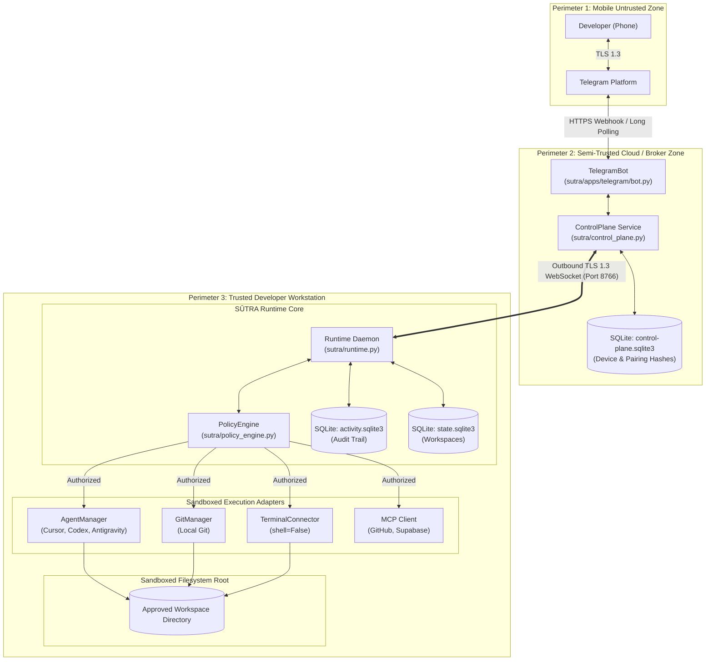
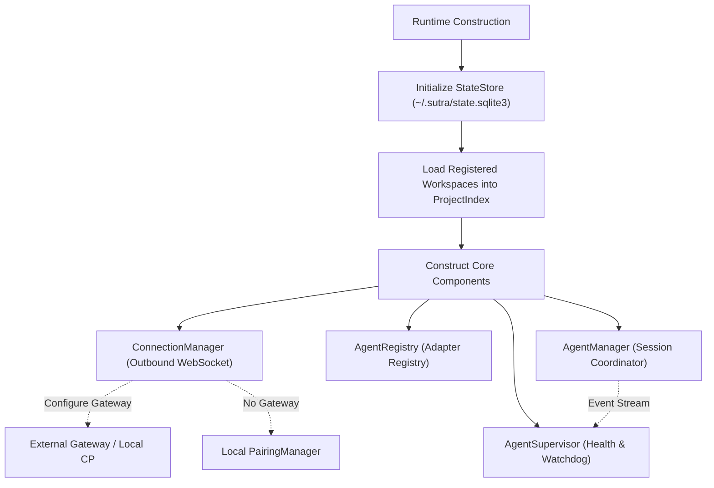
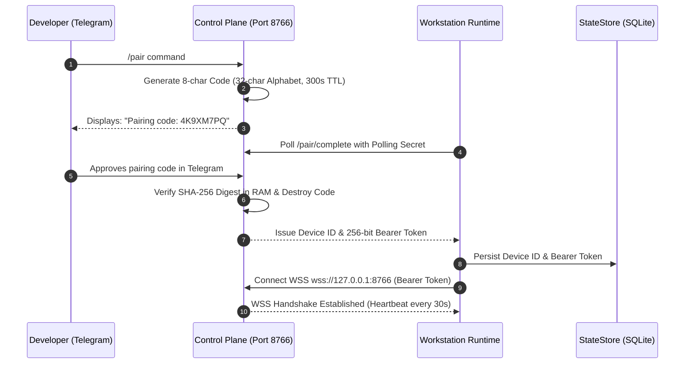
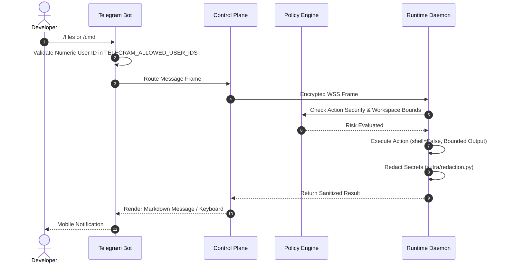
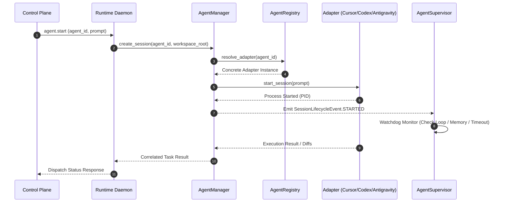
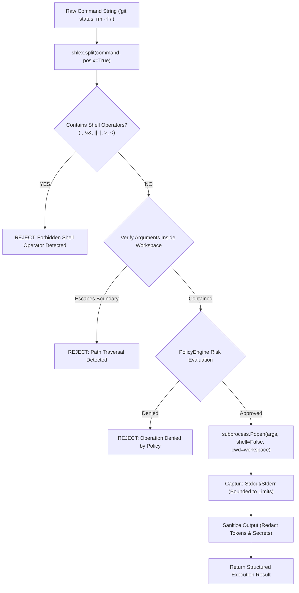
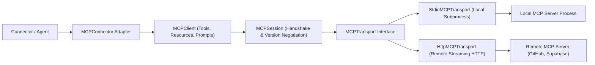
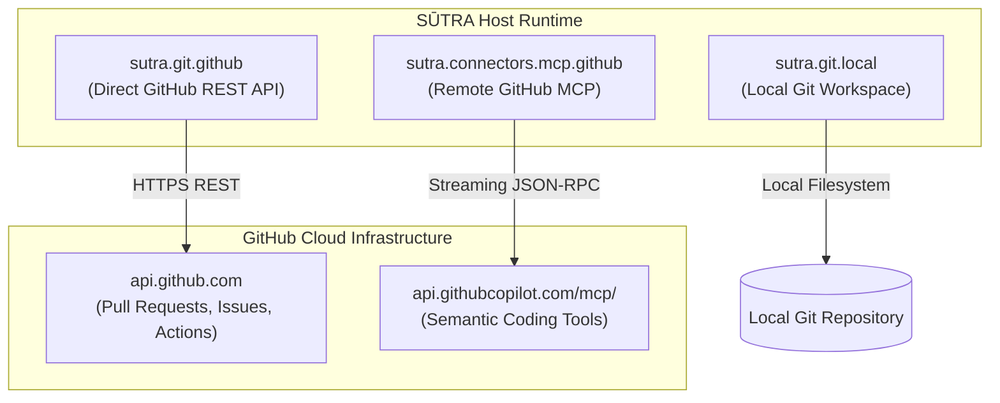
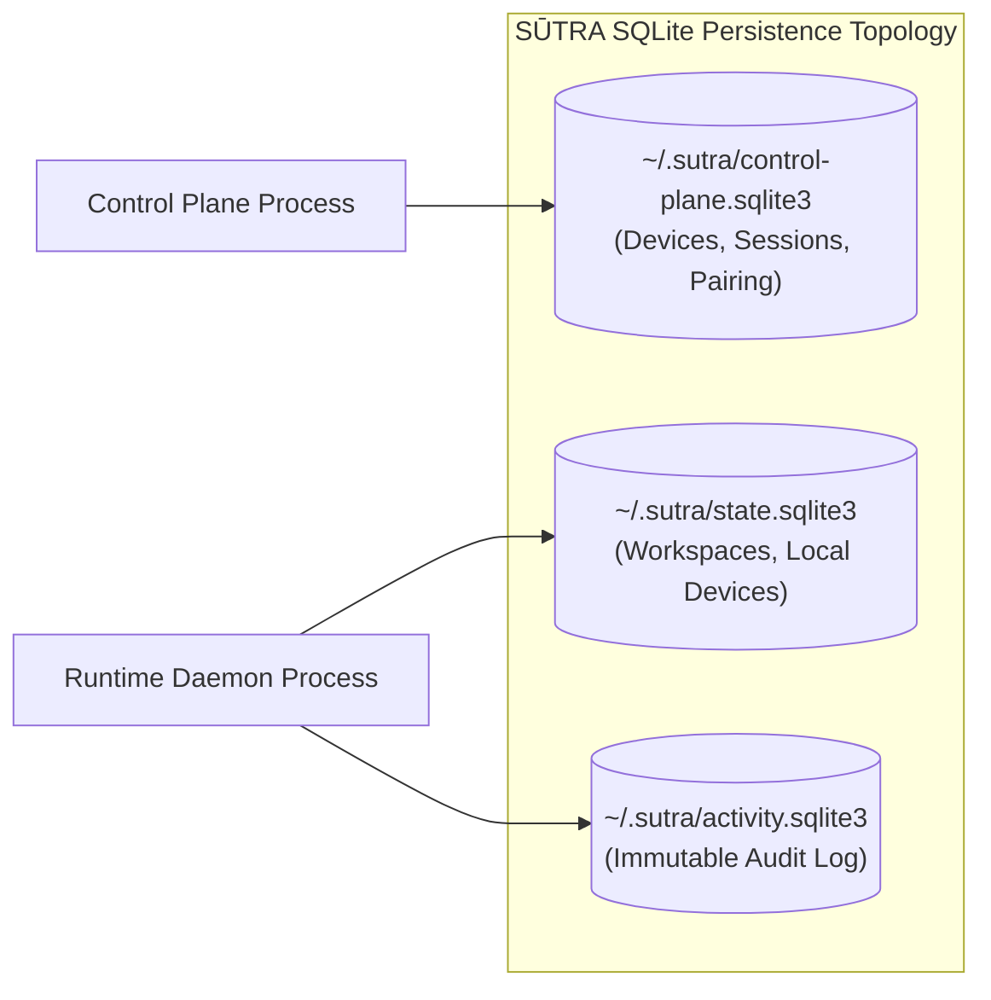

# AI & Runtime Architecture Blueprint — SAMANVAYA · SŪTRA

> **File:** `docs/architecture/ai-architecture.md`  
> **Purpose:** Comprehensive technical blueprint detailing the local runtime, control plane, deterministic policy engine, MCP subsystem, agent adapters, and persistence architecture.  
> **Audience:** System architects, core developers, security evaluators, and contributors.  
> **Status:** Maintained — Verified against the `sutra` package implementation.  

---

## Table of Contents

- [1. Executive Architectural Blueprint](#1-executive-architectural-blueprint)
- [2. System Context & Trust Perimeters](#2-system-context--trust-perimeters)
- [3. Local Runtime Composition & Lifecycle](#3-local-runtime-composition--lifecycle)
- [4. Control Plane, Pairing & WebSocket Protocol](#4-control-plane-pairing--websocket-protocol)
- [5. Deterministic Policy Engine & Permission Flow](#5-deterministic-policy-engine--permission-flow)
- [6. Telegram Mobile Supervision Lifecycle](#6-telegram-mobile-supervision-lifecycle)
- [7. Agent Adapters & Supervisor Subsystem](#7-agent-adapters--supervisor-subsystem)
- [8. Guarded Local Terminal Pipeline](#8-guarded-local-terminal-pipeline)
- [9. Transport-Agnostic MCP Client Infrastructure](#9-transport-agnostic-mcp-client-infrastructure)
- [10. GitHub Integration Models: REST vs. MCP](#10-github-integration-models-rest-vs-mcp)
- [11. Supabase MCP Connector Architecture](#11-supabase-mcp-connector-architecture)
- [12. ActivityStore & Immutable Audit Trail](#12-activitystore--immutable-audit-trail)
- [13. Persistence Architecture & SQLite Topology](#13-persistence-architecture--sqlite-topology)
- [14. Network Resilience, Backoff & Circuit Breakers](#14-network-resilience-backoff--circuit-breakers)
- [15. Architectural Diagram Catalogue](#15-architectural-diagram-catalogue)
- [16. Known Technical Gaps & Limitations](#16-known-technical-gaps--limitations)
- [17. References & Code Map](#17-references--code-map)

---

## 1. Executive Architectural Blueprint

**SAMANVAYA · SŪTRA** (historically known as *AgentBridge*) is an open-source, local-first control plane engineered to supervise autonomous coding agents.

### Architectural Foundation
> **SŪTRA is the control plane. The coding agent is the coding intelligence.**

Autonomous agents produce code suggestions and execute tasks; SŪTRA intercepts, sandboxes, policies, and audits those tasks. Private code never touches cloud brokers, and high-risk operations cannot run without human confirmation.

---

## 2. System Context & Trust Perimeters

SŪTRA establishes three distinct trust perimeters:



### Trust Boundary Rules
1. **Cloud Broker Zero-Code Rule:** The control plane relays encrypted control frames; raw source code is never cached, indexed, or stored remotely.
2. **Untrusted Agent Rule:** Coding agents cannot directly access OS execution shells. Every action is intercepted by `PolicyEngine`.
3. **Numeric Allowlisting:** Telegram requests from user IDs not listed in `TELEGRAM_ALLOWED_USER_IDS` are dropped immediately.

---

## 3. Local Runtime Composition & Lifecycle

The local runtime daemon (`sutra/runtime.py`) manages local workstation processes, registered workspaces, and agent sessions:



### Key Source Evidence
- `sutra/runtime.py:97-124`: Constructs `StateStore`, `ProjectIndex`, `ConnectionManager`, `AgentRegistry`, `AgentManager`, and `AgentSupervisor`.
- `sutra/state.py:7-16`: Initializes local SQLite tables for workspaces, devices, and session state.

---

## 4. Control Plane, Pairing & WebSocket Protocol

The Control Plane (`sutra/control_plane.py`) coordinates operator authentication, device sessions, and message routing over TLS 1.3:



---

## 5. Deterministic Policy Engine & Permission Flow

Every operation is evaluated against a 4-tier risk classification:

```mermaid
flowchart TD
    In["Inbound Request (Tool / Action)"] --> Eval["PolicyEngine.evaluate(operation)"]
    
    Eval --> CheckTier{"Risk Classification"}
    
    CheckTier -->|LOW (git status, ls, diff)| Auto["Auto-Approve (If Configured)"]
    CheckTier -->|MEDIUM (git add, touch, test)| SingleTap["Push Mobile Alert: Tap [ALLOW_ONCE]"]
    CheckTier -->|HIGH (rm, checkout, pip install)| WarnTap["Push Mobile Alert: Warning + Tap"]
    CheckTier -->|CRITICAL (force push, format, drop)| Challenge["Enforce Interactive Double Challenge"]
    
    Auto --> Permit["Execute Requested Operation"]
    SingleTap -->|Approved| Permit
    SingleTap -->|Denied / Timeout| Deny["Raise PermissionDenied"]
    WarnTap -->|Approved| Permit
    WarnTap -->|Denied / Timeout| Deny
    Challenge -->|Validated| Permit
    Challenge -->|Failed| Deny
```

### Safety Invariant
> **CRITICAL operations can NEVER be persisted into `ALLOW_ALWAYS` or auto-approved.**

---

## 6. Telegram Mobile Supervision Lifecycle



---

## 7. Agent Adapters & Supervisor Subsystem

The Agent Manager coordinates third-party coding agent CLIs:



---

## 8. Guarded Local Terminal Pipeline



---

## 9. Transport-Agnostic MCP Client Infrastructure

SŪTRA implements Anthropic's Model Context Protocol (MCP) core:



---

## 10. GitHub Integration Models: REST vs. MCP



---

## 11. Supabase MCP Connector Architecture

The Supabase MCP Connector (`sutra/connectors/mcp/supabase.py`):
1. **Project Ref Validation:** Strict 20-character regex (`^[a-z0-9]{20}$`).
2. **Credential Precedence:** OS Keyring (`service="sutra-connector-supabase"`) $\to$ `SUPABASE_ACCESS_TOKEN`.
3. **Safety Defaults:** Schema inspection and read queries run under `LOW`/`MEDIUM` policy; mutating DDL/DML triggers `CRITICAL` double-confirmation.

---

## 12. ActivityStore & Immutable Audit Trail

The ActivityStore (`sutra/activity_store.py`) persists audit records into `~/.sutra/activity.sqlite3`:

```sql
CREATE TABLE IF NOT EXISTS activities (
    id TEXT PRIMARY KEY,
    timestamp INTEGER NOT NULL,
    correlation_id TEXT NOT NULL,
    connector_id TEXT NOT NULL,
    action TEXT NOT NULL,
    risk_class TEXT NOT NULL,
    decision TEXT NOT NULL,
    duration_ms INTEGER NOT NULL,
    status TEXT NOT NULL,
    error_message TEXT,
    metadata_json TEXT
);
```

All metadata passes through `sutra/redaction.py` to mask API tokens, bearer headers, and private keys.

---

## 13. Persistence Architecture & SQLite Topology



All SQLite databases configure Write-Ahead Logging (`PRAGMA journal_mode=WAL;`) and a 5000ms busy timeout (`PRAGMA busy_timeout=5000;`).

---

## 14. Network Resilience, Backoff & Circuit Breakers

Outbound network connections implement bounded exponential backoff with jitter:

$$T_{\text{wait}} = \min(30, 2 \times 2^{\text{attempt}}) \pm \text{jitter}$$

- **Heartbeat:** Outbound WebSocket ping interval is 30 seconds; missing pings trigger graceful reconnect.
- **Circuit Breakers:** Repeated connector failures trip after 5 consecutive errors, isolating failing connectors without terminating the host daemon.

---

## 15. Architectural Diagram Catalogue

| Diagram ID | Title | Format | Source Path | Description |
| :--- | :--- | :---: | :--- | :--- |
| `arch-01` | System Context & Boundaries | Mermaid | This document (Section 2) | Trust perimeters and mobile-to-workstation topology. |
| `arch-02` | Runtime Composition | Mermaid | This document (Section 3) | Runtime startup and subsystem wiring. |
| `arch-03` | Pairing & Handshake | Mermaid | This document (Section 4) | 8-character ephemeral code pairing and token issuance. |
| `arch-04` | Policy Engine Decision Flow | Mermaid | This document (Section 5) | 4-tier risk classification and human approval hooks. |
| `arch-05` | Telegram Supervision | Mermaid | This document (Section 6) | Inbound message validation and sanitized response flow. |
| `arch-06` | Agent Manager Lifecycle | Mermaid | This document (Section 7) | Adapter coordination, supervisor events, and session states. |
| `arch-07` | Guarded Terminal Pipeline | Mermaid | This document (Section 8) | Lexical tokenization, operator checking, and sandboxed run. |
| `arch-08` | MCP Client Core | Mermaid | This document (Section 9) | Transport abstraction, session negotiation, and tool calls. |
| `arch-09` | GitHub REST vs MCP | Mermaid | This document (Section 10) | Comparison between REST API and MCP Copilot endpoints. |
| `arch-10` | SQLite Storage Topology | Mermaid | This document (Section 13) | WAL mode database distribution across runtime and control plane. |
| `legacy-41`| 41 JSON Diagram Specifications | JSON | `docs/architecture/diagrams/` | Preserved authoritative diagram models across workflows. |

---

## 16. Known Technical Gaps & Limitations

1. **Loopback Default:** Local services bind to `127.0.0.1`. Remote mobile access requires an external secure reverse proxy.
2. **Scaffolded Connectors:** Slack and Discord implementations are non-operational scaffolds reserved for future releases.
3. **Live Testing Separation:** Live GitHub and Supabase operations require operator-supplied personal access tokens.

---

## 17. References & Code Map

- Runtime Daemon: [`sutra/runtime.py`](file:///d:/practice-file/sutra/runtime.py)
- Control Plane: [`sutra/control_plane.py`](file:///d:/practice-file/sutra/control_plane.py)
- Policy Engine: [`sutra/policy_engine.py`](file:///d:/practice-file/sutra/policy_engine.py)
- Activity Store: [`sutra/activity_store.py`](file:///d:/practice-file/sutra/activity_store.py)
- Security Guard: [`sutra/security.py`](file:///d:/practice-file/sutra/security.py)
- MCP Client Core: [`sutra/connectors/mcp/client.py`](file:///d:/practice-file/sutra/connectors/mcp/client.py)
- Connector Framework Architecture: [`docs/architecture/connectors.md`](file:///d:/practice-file/docs/architecture/connectors.md)
