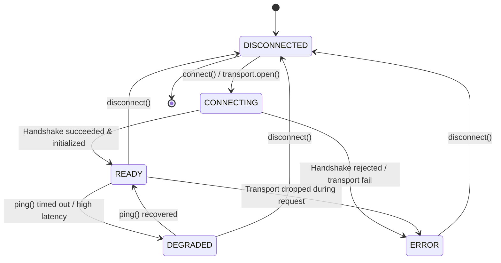

# Model Context Protocol (MCP) Client Core Architecture

> **Phase**: 7.5 — MCP Client Core
> **Status**: Verified & Locked
> **Repository**: `sutra/connectors/mcp/`
> **Specification Target**: Model Context Protocol (MCP) 2026-07-28 (Current Stable), with backwards-compatibility through 2024-11-05.

---

## 1. Executive Summary

Phase 7.5 introduces the transport-agnostic Model Context Protocol (MCP) client core for **AgentBridge**. This implementation provides a clean, robust, and extensible client architecture that bridges external MCP servers directly into AgentBridge's canonical connector ecosystem (`Connector`, `ConnectorRegistry`, `ConnectorAnalyzer`, and `ActivityStore`).

Physical transports (stdio process spawning in Phase 7.6, Streamable HTTP / SSE in Phase 7.7) are completely decoupled behind the abstract `MCPTransport` interface. The core client handles session state transitions, protocol handshake negotiation, bounded pagination, structured exception normalization, secret redaction, and audit correlation.

---

## 2. Architecture & Layering

The MCP integration is structured into five distinct, decoupled layers:

```
+-----------------------------------------------------------------------------+
|                               AgentBridge Runtime                                 |
|            (ControlPlane, Agents, PolicyEngine, ConnectorAnalyzer)          |
+-----------------------------------------------------------------------------+
                                       |
                                       v
+-----------------------------------------------------------------------------+
|               MCPConnector (sutra/connectors/mcp/connector.py)              |
|   - Implements AgentBridge Connector contract (type=ConnectorType.MCP)            |
|   - Audits executions to SQLite ActivityStore with redacted parameters      |
|   - Generates ConnectorAnalysisDescriptor for Phase 7.4 Generic Analyzer    |
+-----------------------------------------------------------------------------+
                                       |
                                       v
+-----------------------------------------------------------------------------+
|                  MCPClient (sutra/connectors/mcp/client.py)                 |
|   - High-level domain APIs: call_tool(), list_resources(), get_prompt()...  |
|   - Bounded pagination (max_pages=50, max_items=1000)                       |
|   - Normalizes all errors to structured ConnectorError hierarchy            |
+-----------------------------------------------------------------------------+
                                       |
                                       v
+-----------------------------------------------------------------------------+
|                 MCPSession (sutra/connectors/mcp/session.py)                |
|   - Finite State Machine: DISCONNECTED -> CONNECTING -> READY / DEGRADED    |
|   - Protocol handshake & multi-version negotiation (2026-07-28 .. 2024-11)  |
|   - Diagnostic ping latency tracking and capability enforcement             |
+-----------------------------------------------------------------------------+
                                       |
                                       v
+-----------------------------------------------------------------------------+
|              MCPTransport Interface (sutra/connectors/mcp/transport.py)     |
|   - Abstract contract: open(), close(), is_connected(), send_request()...  |
|   - In-Memory Test Double: FakeMCPTransport (Phase 7.5)                     |
|   - Concrete stdio Process Transport: StdioMCPTransport (Phase 7.6)        |
|     (See docs/architecture/mcp-stdio.md for subprocess architecture)        |
|   - Concrete HTTP / SSE Transport: HttpMCPTransport (Phase 7.7)            |
|     (See docs/architecture/mcp-http.md for remote HTTP/SSE architecture)    |
+-----------------------------------------------------------------------------+
```

---

## 3. Protocol Version Negotiation

AgentBridge MCP Client negotiates protocol revisions during the `initialize` handshake:

| Protocol Revision | Status | Capabilities Supported |
|---|---|---|
| `2026-07-28` | **Current Stable** | Tools, Resources, Prompts, Pagination, List Changed Notifications |
| `2025-03-26` | **Supported Default** | Tools, Resources, Prompts, Pagination |
| `2024-11-05` | **Backwards Compatible** | Legacy tools and basic resource reads |

Negotiation rule: The client offers `2026-07-28`. If the server returns an older supported version (e.g. `2024-11-05`), the client downgrades gracefully and operates within the bounds of that version.

---

## 4. Session State Machine

The session lifecycle is tracked explicitly via `MCPSessionState`:



---

## 5. Security & Safety Controls

1. **Parameter & Metadata Scrubbing**:
   All parameters passed to `call_tool`, `get_prompt`, and `ConnectorDescriptor.metadata` are sanitized through `sanitize_metadata()`. Keys matching passwords, tokens, API keys, and credentials are replaced with `[REDACTED]`.
2. **Output Redaction**:
   All text outputs returned from MCP tools and resources are processed by `redact_secrets()`, ensuring raw tokens or private keys are never leaked to logs or storage.
3. **ActivityStore Auditing**:
   Every tool invocation records a start event with `arguments_redacted` and an end event with duration and status (`success` or `error`) into the SQLite `tool_calls` table.
4. **PolicyEngine Authority**:
   Mutating operations require permission verification via `PolicyEngine.check_permission(create_permission_request(...))` prior to execution.

---

## 6. Verification & Quality Gate

Phase 7.5 implementation is validated by 24 comprehensive test groups in `tests/test_mcp_client.py`:

- **Group A**: Client lifecycle (connect, handshake, idempotent connect, ping, disconnect).
- **Group B**: Protocol version negotiation (latest, fallback to 2024-11-05).
- **Group C**: Capability discovery and mapping to `ConnectorCapability`.
- **Group D & E**: Server and client metadata negotiation.
- **Group F & G**: Tools listing and execution (`call_tool`).
- **Group H & I**: Resources listing and reading (`read_resource`).
- **Group J & K**: Prompts listing and rendering (`get_prompt`).
- **Group L**: Bounded cursor pagination (`max_pages`, `max_items`).
- **Group M & N**: Structured results and error normalization.
- **Group O & P**: Timeout and async cancellation propagation.
- **Group Q**: PermissionEngine compatibility.
- **Group R**: Shared resilience integration (`with_timeout_and_retry`).
- **Group S & T**: ActivityStore correlation and secret redaction.
- **Group U**: Unsupported capability rejection.
- **Group V**: Sudden transport disconnection handling.
- **Group W**: Backwards compatibility with 2024-11-05 servers.
- **Group X**: ConnectorRegistry registration and Phase 7.4 Generic Analyzer verification.
