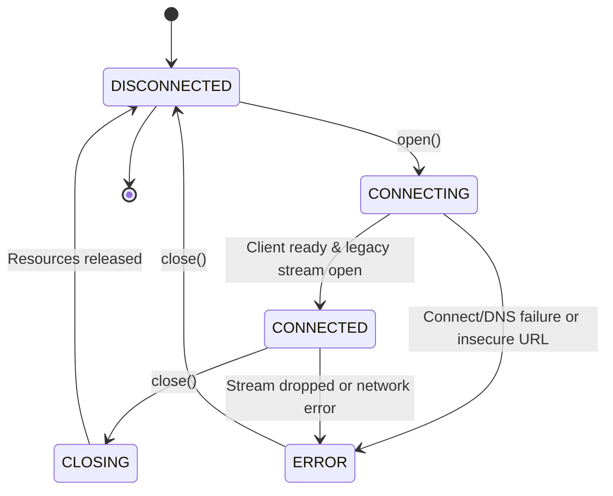

# Model Context Protocol (MCP) Remote HTTP Transport Architecture

> **Phase**: 7.7 — Remote MCP Transport
> **Status**: Verified & Locked
> **Repository**: `sutra/connectors/mcp/`
> **Specification Target**: Model Context Protocol (MCP) Streamable HTTP Specification (Current Stable), with backwards-compatibility for legacy MCP Server-Sent Events (SSE).

---

## 1. Executive Summary

Phase 7.7 delivers the concrete remote HTTP transport implementation for **AgentBridge**. This enables AgentBridge to communicate securely with remote MCP servers over the internet or private networks using the abstract `MCPTransport` contract established in Phase 7.5.

The primary transport mode is modern **MCP Streamable HTTP** (POST requests delivering direct JSON or streaming Server-Sent Events chunks). For backwards compatibility with older servers, an isolated **Legacy SSE** mode (GET `/sse` event stream with POST to an announced message endpoint) is fully supported.

The HTTP transport integrates directly into the existing AgentBridge architecture:
```
MCPConnector
    │
    ▼
MCPClient
    │
    ▼
MCPSession
    │
    ▼
HttpMCPTransport (implements MCPTransport)
    │
    ▼
Remote MCP Server (Streamable HTTP / SSE)
```

---

## 2. Streamable HTTP Architecture

Modern MCP servers use **Streamable HTTP** as the standard HTTP-based transport:

1. **Protocol Framing**:
   - Outgoing requests are transmitted as HTTP POST requests with `Content-Type: application/json`.
   - The client sets `Accept: application/json, text/event-stream`.
   - The request body contains a standard JSON-RPC 2.0 object (`{"jsonrpc": "2.0", "id": 1, "method": "...", "params": {...}}`).

2. **Dual-Mode Response Consumption**:
   - **Direct JSON (`application/json`)**: The server returns an immediate HTTP 200 containing the JSON-RPC response body (`result` or `error`).
   - **Streaming SSE (`text/event-stream`)**: The server responds with an SSE event stream on the POST connection itself, emitting `event: message\ndata: {...}\n\n` frames until the response is complete.

3. **Session Tracking**:
   - Servers identify persistent sessions via the `mcp-session-id` HTTP header.
   - Upon receiving this header, `HttpMCPTransport` records the session ID and automatically echoes it in all subsequent requests.

---

## 3. Legacy SSE Compatibility

To maintain full interoperability with legacy MCP servers (e.g. initial 2024-11-05 deployments), `HttpMCPTransport` provides an isolated legacy mode (`legacy_sse=True`):

1. **Stream Initiation**: On `open()`, the transport connects via HTTP GET to the `/sse` endpoint with `Accept: text/event-stream`.
2. **Endpoint Announcement**: The server emits an initial SSE event:
   ```
   event: endpoint
   data: /messages?sessionId=xyz
   ```
3. **Request Dispatch**: Subsequent JSON-RPC requests are dispatched via HTTP POST to the announced relative/absolute URL (`/messages`). Responses are delivered asynchronously over the active GET SSE stream and matched by JSON-RPC `id`.
4. **Teardown**: On `close()`, the background reader task and GET response stream are cleanly terminated.

---

## 4. Lifecycle & Finite State Machine

The transport lifecycle transitions across five deterministic states:



- **`DISCONNECTED`**: No active HTTP connection. Calls to `send_request` raise `ConnectorNotConnectedError`.
- **`CONNECTING`**: `httpx.AsyncClient` is configured; URL scheme and security policies are validated.
- **`CONNECTED`**: Ready to dispatch requests and process responses.
- **`CLOSING`**: In-flight requests are cancelled or aborted; active streams are cleanly closed.
- **`ERROR`**: Encountered an unrecoverable network failure, handshake rejection, or stream error.

---

## 5. Security & Safety Controls

1. **HTTPS Enforcement**:
   - Plain HTTP (`http://`) is strictly rejected for remote hosts unless explicitly configured with `allow_http=True`.
   - Local development hosts (`localhost`, `127.0.0.1`, `::1`, `0.0.0.0`, `.local`) are permitted over HTTP for frictionless local testing.
2. **Arbitrary Protocol Rejection**:
   - Schemes other than `http` and `https` (e.g. `file:`, `ftp:`, `javascript:`, `ws:`) are rejected immediately with `ConnectorInvalidRequestError`.
3. **Authentication Boundary**:
   - Static headers (`config.headers`) and dynamic token generators (`config.auth_provider`) are injected in-memory per request.
   - Headers matching sensitive tokens (`Authorization`, `X-Api-Key`, `Cookie`, `Token`, `Secret`) are masked via `_sanitize_headers` and never appear in `transport_info()`, ActivityStore, logs, or metrics.
4. **Bounded Redirects & Framing Limits**:
   - Redirects are capped at `max_redirects` (default 5).
   - Response bodies are capped at `max_response_bytes` (10MB default) to prevent memory exhaustion.
   - SSE chunks are capped at `max_event_bytes` (1MB default).

---

## 6. Timeouts & Cancellation Behavior

Bounded deadlines govern every phase of the connection:
- `connect_timeout` (default 10s): Maximum time to establish TCP/TLS connection.
- `request_timeout` (default 30s): Default per-request write/read deadline.
- `read_timeout` (default 30s): Maximum duration to wait for chunks from streaming responses.
- `shutdown_timeout` (default 5s): Grace period for clean stream termination on `close()`.

When an in-flight request is cancelled (`asyncio.CancelledError`), the cancellation propagates immediately, response streams are closed, and connection resources are released without task leaks.

---

## 7. Resilience & Retry Rules

1. **Failure Classification**:
   - Transient failures (HTTP 429, HTTP 502/503/504, connection reset, timeouts) can be retried via AgentBridge's centralized `with_timeout_and_retry`.
   - Permanent failures (HTTP 400, 401, 403, 404, invalid JSON-RPC) fail fast without retrying.
2. **Strict Idempotency Preservation**:
   - Read-only queries (`ping`, `tools/list`, `resources/read`) can be retried safely.
   - Mutating tool invocations (`tools/call` with write operations) must NOT be blindly retried without an idempotency key.

---

## 8. Error Normalization

Remote HTTP failures map directly to canonical AgentBridge `ConnectorError` abstractions:

| Condition | Status / Exception | Mapped AgentBridge Error |
|---|---|---|
| Unauthorized | HTTP 401 | `ConnectorAuthError` |
| Forbidden | HTTP 403 | `ConnectorPermissionError` |
| Not Found | HTTP 404 | `ConnectorNotFoundError` |
| Rate Limited | HTTP 429 | `ConnectorUnavailableError` |
| Server Error | HTTP 5xx | `ConnectorProviderError` |
| Connect Failure | `httpx.ConnectError` | `ConnectorConnectionError` |
| Timeout | `httpx.TimeoutException` | `ConnectorTimeoutError` |
| Malformed JSON | `json.JSONDecodeError` | `ConnectorProviderError` |

---

## 9. Generic Connector Analyzer Integration

`MCPConnector.identity().metadata` safely exposes the remote HTTP descriptor:
- `transport`: `"HttpMCPTransport"`
- `mode`: `"streamable_http"` or `"legacy_sse"`
- `url`: Masked endpoint URL (passwords stripped)
- `has_auth`: Boolean indicating whether credentials/auth hooks are configured

The Phase 7.4 Generic Connector Analyzer validates HTTP connectors across its 12 inspection stages without provider-specific logic, cleanly isolating `CONFIGURED`, `CONNECTED`, and `HEALTHY` states.
