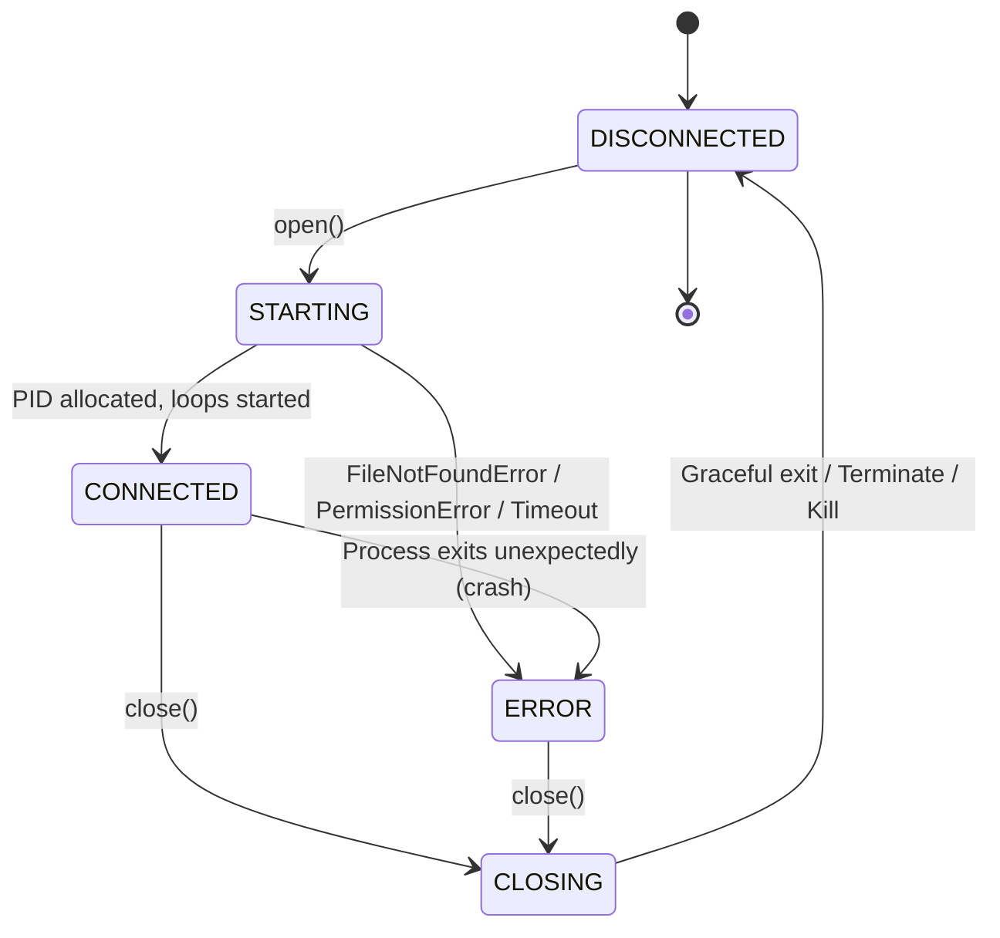

# Model Context Protocol (MCP) Stdio Transport Architecture

> **Phase**: 7.6 — MCP Stdio Transport
> **Status**: Verified & Locked
> **Module**: `sutra/connectors/mcp/stdio.py`
> **Contract**: Implements `MCPTransport` (`sutra/connectors/mcp/transport.py`)

---

## 1. Executive Summary

Phase 7.6 implements the concrete, local subprocess `stdio` transport for the **Model Context Protocol (MCP)** in **AgentBridge**.

This enables AgentBridge to spawn and communicate directly with local MCP server processes over standard streams:
- **`stdin`**: AgentBridge writes line-delimited JSON-RPC 2.0 requests and notifications.
- **`stdout`**: AgentBridge reads line-delimited JSON-RPC 2.0 responses and notifications.
- **`stderr`**: Asynchronously captured into a bounded ring buffer for diagnostic logging without ever corrupting the protocol stream on stdout.

The transport operates completely within the AgentBridge Connector architecture established in Phases 7.2–7.5, maintaining strict security boundaries, secret sanitization, cross-platform process management, and ActivityStore auditing.

---

## 2. Process Configuration (`MCPStdioConfig`)

Process execution is configured using the strongly typed `MCPStdioConfig` model:

```python
@dataclass(frozen=True)
class MCPStdioConfig:
    command: str
    args: tuple[str, ...] = ()
    env: Optional[Mapping[str, str]] = None
    cwd: Optional[Union[str, Path]] = None
    startup_timeout: float = 10.0
    request_timeout: float = 30.0
    shutdown_timeout: float = 5.0
    kill_timeout: float = 2.0
    max_stderr_lines: int = 200
    max_stderr_bytes: int = 65536
    max_frame_bytes: int = 10 * 1024 * 1024  # 10MB
    clean_env: bool = False
    env_allowlist: Optional[tuple[str, ...]] = None
    capture_stderr: bool = True
```

### Security & Sanitization Rules
1. **Zero Shell Execution**: Processes are invoked strictly with `shell=False` via `asyncio.create_subprocess_exec`. Arguments are passed as an explicit array preserving `argv` boundaries, completely eliminating shell injection vulnerabilities.
2. **Environment Isolation**:
   - When `clean_env=True`, inherited environment variables are stripped down to essential system runtime variables (`PATH`, `SYSTEMROOT`, `TEMP`, `PYTHONPATH`, `HOME`, etc.) or those matching `env_allowlist`.
   - Passwords, API tokens, and credentials in custom `env` dictionaries are never logged in plaintext; `config.sanitized_dict()` masks sensitive keys as `[REDACTED]`.

---

## 3. Protocol Framing & Stream Separation

```
  AgentBridge Runtime (StdioMCPTransport)
        │
        ├── [stdin write]  ─── JSON-RPC 2.0 line-delimited (\n) ───► Child Process
        │
        ├── [stdout read]  ◄── JSON-RPC 2.0 line-delimited (\n) ─── Child Process
        │
        └── [stderr read]  ◄── Diagnostic log lines (bounded buffer) ── Child Process
```

### 3.1 Line-Delimited JSON-RPC (stdout)
- Messages must be strictly newline-delimited (`\n`) without embedded newlines.
- Handled by asynchronous reader loop `_read_stdout_loop()`.
- Maximum frame guard (`max_frame_bytes = 10MB`) protects against unbounded memory allocation from rogue processes.
- Non-JSON garbage on stdout is captured and translated into normalized `ConnectorProviderError` without crashing the transport.

### 3.2 Bounded Stderr Ring Buffer
- Captured continuously by `_read_stderr_loop()`.
- Buffers up to `max_stderr_lines` (default 200) and `max_stderr_bytes` (default 64KB).
- Prevents pipe buffer exhaustion and child process deadlocks.
- Sensitive strings in stderr lines are scrubbed with `redact_secrets()`.
- Exposes `get_stderr_tail()` for diagnostic context when a process crashes or times out.

---

## 4. Subprocess Lifecycle State Machine



### 4.1 Teardown Sequence (`_safe_terminate_process`)
1. **Orderly Stdin Close**: Closes `stdin` stream to signal EOF. Many servers exit immediately upon receiving EOF. Waits up to `shutdown_timeout` (default 5.0s).
2. **Graceful Terminate**: If still active, invokes `proc.terminate()` (`SIGTERM` on POSIX, `TerminateProcess` on Windows). Waits up to `kill_timeout` (default 2.0s).
3. **Forced Kill**: If still running, calls `proc.kill()` (or `taskkill /F /T` on Windows to clean up child process trees).
4. **Zombie Prevention**: Always awaits `proc.wait()` to reap the process handle.

---

## 5. Integration with AgentBridge Ecosystem

1. **Connector Layering**:
   ```
   MCPConnector (connector.py)
       └── MCPClient (client.py)
             └── MCPSession (session.py)
                   └── StdioMCPTransport (stdio.py)
                         └── Child Process (stdin/stdout)
   ```
2. **Generic Analyzer Integration**:
   `MCPConnector` with `StdioMCPTransport` reports `transport="StdioMCPTransport"` and `declared_binary_names=(config.command,)`. The Phase 7.4 `ConnectorAnalyzer` verifies the binary with `CLIProbe`, checks connectivity via `ping()`, and validates capabilities without provider branching.
3. **PolicyEngine Authorization**:
   Mutating tool calls dispatched over stdio require prior authorization via `PolicyEngine.check_permission()`.
4. **ActivityStore Auditing**:
   Every stdio tool invocation logs running start and completed duration to the SQLite `tool_calls` table with redacted parameters and results.

---

## 6. Verification & Test Matrix

The dedicated test suite [tests/test_mcp_stdio.py](../../tests/test_mcp_stdio.py) covers 26 scenarios (A through Z):

| Group | Scenario | Result |
|:---:|---|:---:|
| **A** | Startup success, PID allocation, ping | **PASSED** |
| **B** | Executable missing (`ConnectorNotFoundError`) | **PASSED** |
| **C** | Invalid arguments / empty command (`ConnectorInvalidRequestError`) | **PASSED** |
| **D** | Startup timeout | **PASSED** |
| **E** | Stdin/stdout communication | **PASSED** |
| **F** | Stderr isolation & non-deadlock buffering | **PASSED** |
| **G** | Tools listing (`list_tools`) | **PASSED** |
| **H** | Tools execution (`call_tool`) | **PASSED** |
| **I** | Resources listing & reading (text and binary) | **PASSED** |
| **J** | Prompts listing & template retrieval | **PASSED** |
| **K** | Cursor pagination over stdio | **PASSED** |
| **L** | Server metadata negotiation | **PASSED** |
| **M** | Capability discovery mapping | **PASSED** |
| **N** | Malformed stdout handling | **PASSED** |
| **O** | Stdout EOF detection | **PASSED** |
| **P** | Process crash detection (exit code 42 captured) | **PASSED** |
| **Q** | Request timeout (`ConnectorTimeoutError`) | **PASSED** |
| **R** | Asyncio cancellation propagation | **PASSED** |
| **S** | Graceful shutdown via stdin EOF | **PASSED** |
| **T** | Forced shutdown fallback within kill_timeout | **PASSED** |
| **U** | Idempotent close handling | **PASSED** |
| **V** | Secret redaction in config and outputs | **PASSED** |
| **W** | Permission enforcement via PolicyEngine | **PASSED** |
| **X** | ActivityStore correlation & SQLite audits | **PASSED** |
| **Y** | Phase 7.4 Generic ConnectorAnalyzer verification | **PASSED** |
| **Z** | Cross-platform environment filtering | **PASSED** |

**Regression Baseline:** 697 passed, 2 skipped, 0 failed across the entire test suite.
