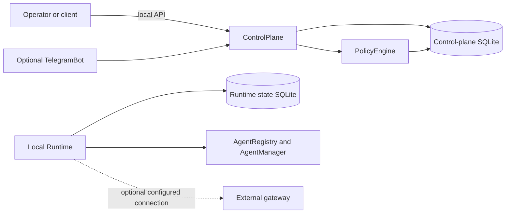

# AgentBridge Architecture Overview

> **File:** `docs/architecture/overview.md`
> **Purpose:** Provide a concise map of the current AgentBridge architecture and point to source-backed detail.
> **Audience:** Contributors and maintainers.
> **Status:** Current-state entry point; see the detailed guide for evidence and known limitations.

## Current system boundary

The repository contains a workstation runtime and a control-plane service. The runtime binds its local API to loopback and may connect to a gateway configured outside this repository. The control plane owns pairing, device sessions, policy evaluation, and activity history. Telegram is an optional app. Neither a hosted gateway nor a general model-serving service is provided by the repository.

This diagram is a high-level summary. It does not show every endpoint or permission check. For repository paths, source line references, persistence ownership, session flow, and validation status, see the [AI and Runtime Architecture guide](ai-architecture.md) and the [Archify diagram](diagrams/sutra-runtime.architecture.html).

## Subsystem references

- [Runtime workflow](runtime-workflow.md) — local startup, workspaces, and command dispatch.
- [Permissions](permissions.md) — permission and approval behavior.
- [Connector registry](connector-registry.md) — connector registration and capability boundaries.
- [Failure handling](failure-handling.md) — retries, degraded paths, and failure behavior.
- [Security threat model](../security/threat-model.md) — trust assumptions and security limits.

Package metadata, imports, and CLI names remain `sutra-local` and `sutra`; the working product name in documentation is AgentBridge. See [TRD.md](../../TRD.md) for the current package/product naming discrepancy and implementation gaps.
