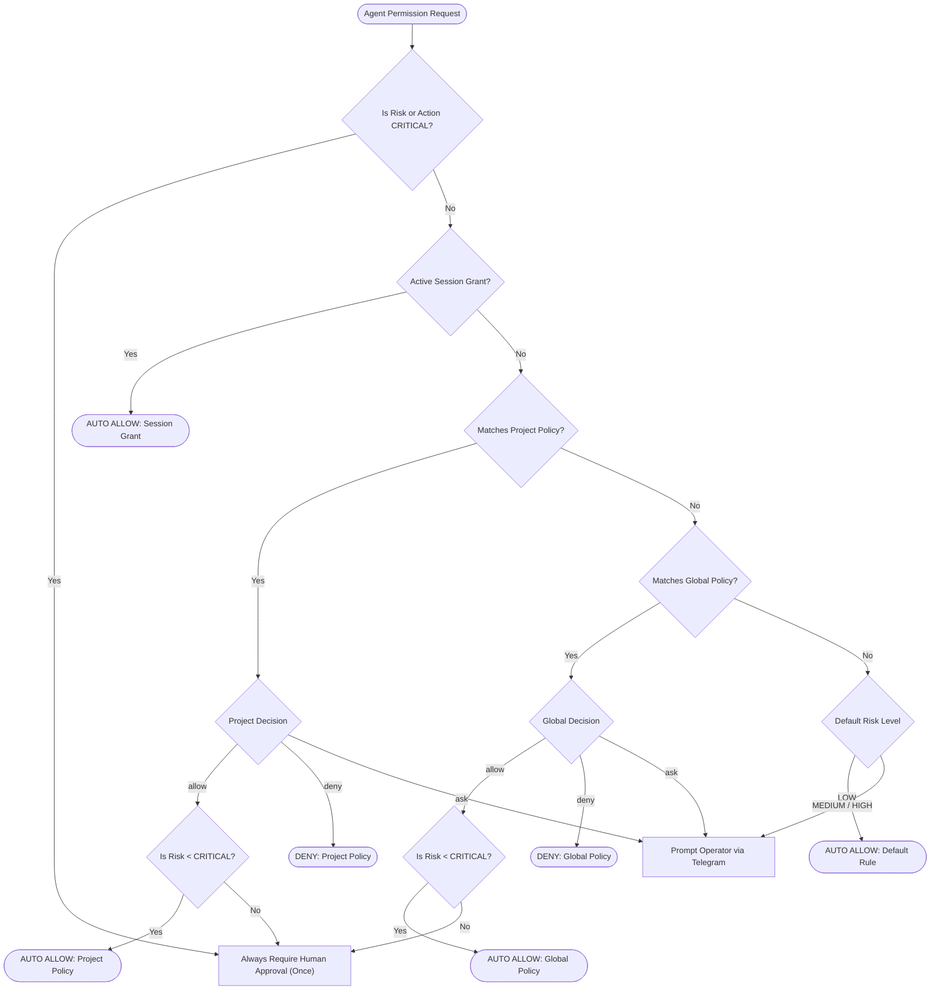

# AgentBridge — Permission & Policy Architecture

This document describes the design, security invariants, precedence model, and operational workflows of the AgentBridge Permission & Policy System.

---

## 1. Design Principles

1. **Safety First**: Destructive and irreversible operations must never be auto-approved without explicit human confirmation.
2. **Deterministic Precedence**: Evaluation follows a strict hierarchy where narrow scopes override broad scopes, and hard safety rules override all configuration.
3. **Auditability**: Every policy mutation (create, update, delete, reset) and evaluation decision generates an immutable audit record in SQLite.
4. **Session Ephemerality**: Session-scoped grants are held in memory and automatically cleared when an agent session terminates or disconnects.
5. **Zero Breaking Changes**: When no persistent policies exist, the system behaves identically to the baseline `PermissionEngine`.

---

## 2. Layered Precedence Resolution

When an agent requests permission for an action, [`PolicyEngine.check_permission()`](../../sutra/policy_engine.py) evaluates the request using the following deterministic chain:



### Precedence Order
1. **CRITICAL Invariant Rule**: Unconditionally requires explicit human approval for each occurrence. Cannot be bypassed by persistent policies or session grants.
2. **Session Grants**: Granted by the operator clicking `✅ Allow Session` in Telegram. Valid for the lifetime of the active session.
3. **Project-Scoped Policies**: Persistent rules configured for a specific workspace directory (`scope_type="project"`, `scope_id=workspace_path`). Overrides global policies.
4. **Global Policies**: Persistent rules applying across all workspaces (`scope_type="global"`).
5. **Default Engine Rules**: Built-in `PermissionEngine` heuristics (e.g., read actions are `LOW` risk and auto-allowed; write/shell actions are `MEDIUM`/`HIGH` and prompt).

---

## 3. Storage Schema & Migrations

Persistent policies and audit logs reside in the central SQLite database managed by [`PolicyStore`](../../sutra/policy_store.py).

### Schema Tables

```sql
CREATE TABLE IF NOT EXISTS permission_policies (
    policy_id       TEXT PRIMARY KEY,
    scope_type      TEXT NOT NULL,          -- 'global' or 'project'
    scope_id        TEXT NOT NULL DEFAULT '',-- workspace absolute path for project
    action_type     TEXT NOT NULL,          -- e.g. 'file_write', 'bash_exec', '*'
    decision        TEXT NOT NULL,          -- 'allow', 'ask', 'deny'
    risk_level      TEXT NOT NULL DEFAULT 'medium', -- 'low', 'medium', 'high', 'critical'
    description     TEXT NOT NULL DEFAULT '',
    created_at      REAL NOT NULL,
    updated_at      REAL NOT NULL,
    enabled         INTEGER NOT NULL DEFAULT 1
);

CREATE TABLE IF NOT EXISTS policy_audit_log (
    audit_id        TEXT PRIMARY KEY,
    timestamp       REAL NOT NULL,
    event_type      TEXT NOT NULL,          -- 'created', 'updated', 'deleted', 'evaluated', 'reset'
    policy_id       TEXT NOT NULL DEFAULT '',
    scope_type      TEXT NOT NULL DEFAULT '',
    scope_id        TEXT NOT NULL DEFAULT '',
    action_type     TEXT NOT NULL DEFAULT '',
    decision        TEXT NOT NULL DEFAULT '',
    actor           TEXT NOT NULL DEFAULT 'system',
    details         TEXT NOT NULL DEFAULT '{}'
);
```

### Automatic Migration
On initialization, `PolicyStore` checks for existing tables, creates them if missing, and verifies indices:
- `idx_policies_lookup` on `(scope_type, scope_id, action_type, enabled)`
- `idx_audit_timestamp` on `(timestamp DESC)`

---

## 4. Telegram Approval Integration

When an action requires operator confirmation:
1. An inline keyboard prompt is dispatched to allowlisted Telegram chats:
   - `✅ Allow Once`: Approves only this exact execution.
   - `✅ Allow Session`: Registers an in-memory session grant for `(session_id, action_type)`.
   - `❌ Deny`: Rejects the tool call.
   - `✏️ Modify`: Requests parameter refinement.
2. The user can view existing persistent policies via the `🔐 Permissions` menu by clicking `📋 View Policies`.
