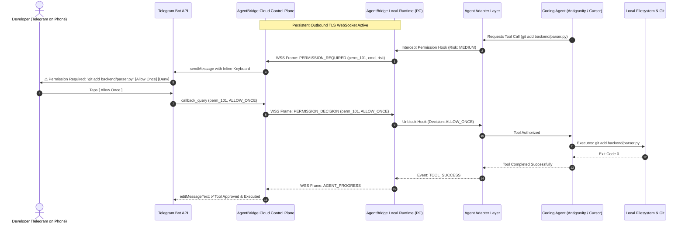
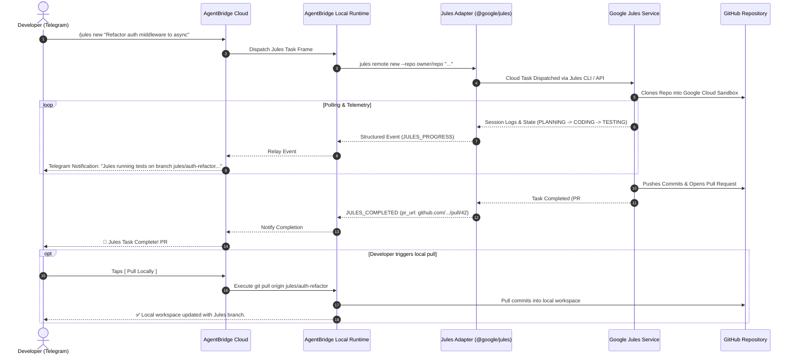
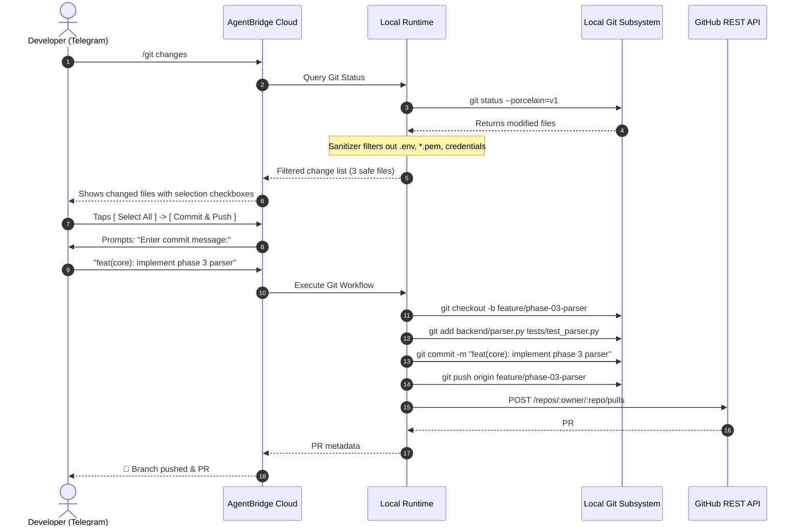

# AgentBridge Sequence & Protocol Flows

## 1. Remote Command & Permission Approval Flow

This diagram illustrates how a blocked coding agent on a home PC communicates a permission request through AgentBridge to a developer on mobile Telegram and receives confirmation without requiring inbound ports.

---

## 2. Jules Remote Asynchronous Workflow

This diagram highlights the fundamental operational difference between local agents (which execute against the local filesystem) and **Jules** (which operates asynchronously against remote GitHub repositories).

---

## 3. Safe Selective Git Staging & PR Workflow

