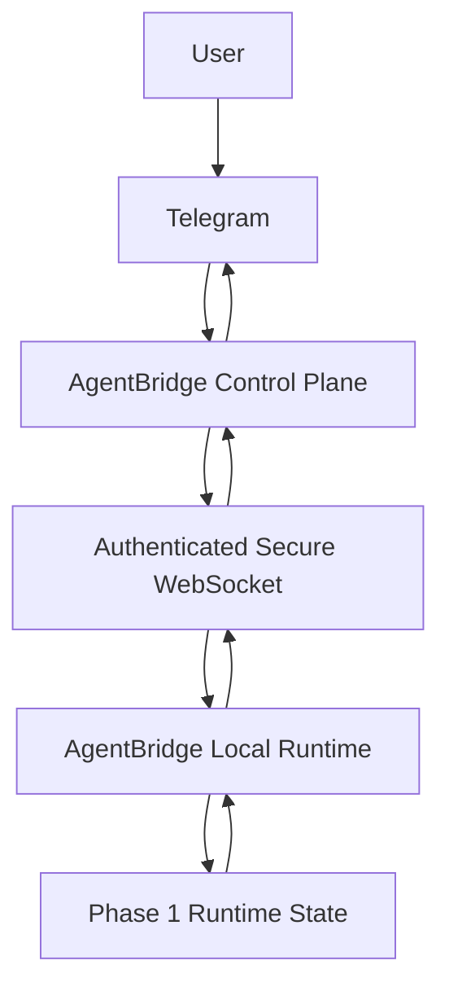

# Phase 2: Remote Control Plane

Phase 2 adds a locally runnable TLS control plane and an authenticated outbound WSS session for the Phase 1 runtime. It supports device pairing/revocation, safe runtime/project queries, and a read-only project file navigator with bounded text preview/export. It does not remotely run agents, edit files, or execute shell/Git commands.

## Architecture



Telegram is an optional long-polling client inside the control-plane process. It checks private-chat user IDs against `TELEGRAM_ALLOWED_USER_IDS`, routes requests through the control plane, and has no connection to the PC other than that control plane.

## Local TLS development

Install the package and the optional certificate-generation dependency, then create a short-lived localhost certificate:

```powershell
python -m pip install -e ".[dev]"
sutra dev-certificate
```

Set these values in `.env` (keep the operator token random and private):

```env
SUTRA_CONTROL_PLANE_TOKEN=<random value of at least 32 characters>
SUTRA_TLS_CERTFILE=.dev-certs/localhost-cert.pem
SUTRA_TLS_KEYFILE=.dev-certs/localhost-key.pem
SUTRA_GATEWAY_URL=wss://127.0.0.1:8766/v1/devices/connect
SUTRA_CONTROL_PLANE_URL=https://127.0.0.1:8766
SUTRA_TLS_CA_FILE=.dev-certs/localhost-cert.pem
TELEGRAM_BOT_TOKEN=<BotFather token, optional>
TELEGRAM_ALLOWED_USER_IDS=<numeric Telegram user ID, optional>
```

Start `sutra control-plane` in one terminal and `sutra local` in another. The runtime prints a one-time code. Send `/pair CODE` to the configured bot from an allowlisted private Telegram account. The runtime polls the control plane over HTTPS and saves its distinct device credential to its local SQLite state. Pairing credentials are stored as hashes by the server; a device credential expires after 30 days and can be revoked with `/revoke DEVICE_ID`.

For a remote host, use a DNS name covered by a certificate trusted by both sides. Configure the runtime's `SUTRA_TLS_CA_FILE` if its issuing CA is not in the operating system trust store. The server refuses to start without a TLS certificate and private key. The development certificate is only valid for localhost and expires after two days.

## API and protocol

The server exposes unauthenticated `GET /health` with aggregate active-session count and uptime. Operator-only routes use `Authorization: Bearer <SUTRA_CONTROL_PLANE_TOKEN>`:

* `GET /v1/devices`
* `POST /v1/devices/{device_id}/revoke`
* `POST /v1/devices/{device_id}/commands` with `{"command":"runtime.status","payload":{}}`
* `POST /v1/pairing/approve` (Telegram pairing uses the same broker directly after allowlist validation)

Pairing itself uses `POST /v1/pairing/requests`, then one-time `GET /v1/pairing/requests/{request_id}/complete` with a random polling secret in the Bearer header. The pairing code is random, expires after five minutes, and cannot be reused. TLS protects the one-time token response. Only the token hash is persisted by the control plane; the raw token is held temporarily in process memory until the paired runtime retrieves it.

The runtime connects to `/v1/devices/connect` using WSS with a Bearer device token and `X-AgentBridge-Device-ID`. Frames are JSON and limited to 32 KiB. UUIDv4 frame/request IDs are correlated to a single device. Frames older than 60 seconds and replayed heartbeats/events are rejected. The runtime sends heartbeats every 20 seconds; the server marks the device offline after 60 seconds without a valid heartbeat. An unanswered command times out after 10 seconds.

Example command:

```json
{"type":"command","request_id":"<uuid>","device_id":"AB-PC-ABC123","command":"runtime.status","payload":{},"sent_at":1780000000}
```

Example response:

```json
{"type":"response","request_id":"<same uuid>","device_id":"AB-PC-ABC123","status":"success","payload":{"connection":"connected"},"sent_at":1780000000}
```

The status allowlist is `runtime.status`, `runtime.health`, `workspace.list`, and `project.list`, all with empty payloads. Read-only file commands are `file.list`, `file.preview`, and `file.download`; requests are revalidated against registered access roots and require a currently discovered project root. Directory browsing and file reads stay inside that selected project. An explicitly approved drive/share root permits bounded discovery only; it does not permit browsing arbitrary files under that root. Preview accepts UTF-8 files up to 256 KiB and is paginated; download accepts UTF-8 files up to 14 KiB. Common credential assignments, token prefixes, and private-key blocks are redacted. Binary files, `.env*`, private-key/database extensions, and obviously sensitive names are excluded. Responses match the pending request ID and device ID. Runtime status events use `type: event` and `event: runtime.status_changed`; the server also records connection status changes. Heartbeats use `type: heartbeat` and receive a `heartbeat_ack` with the same frame ID.

Telegram supports `/help`, `/pair CODE`, `/devices`, `/status [DEVICE_ID]`, `/workspaces`, `/projects`, and `/revoke DEVICE_ID`. When multiple devices are connected, status/workspace/project commands require an explicit device ID. Update IDs are persisted to avoid processing duplicates.

## Security boundaries and limitations

* Device credentials are separate from Phase 1 local-pairing tokens, randomly generated, time-limited, hash-persisted, and revocable.
* Pairing polls use a separate random secret; only its hash is held by the control plane.
* Operator APIs require a distinct bearer token. Telegram accepts private messages only from configured numeric user IDs.
* The runtime accepts only the status commands with empty payloads and the three constrained, read-only file commands. There is no shell, file modification, arbitrary drive access, Git, agent, MCP, or LLM command.
* Text redaction uses common-pattern matching and cannot guarantee detection of every possible secret embedded in ordinary source text. Review this limit before enabling Telegram file transfer for sensitive workspaces.
* SQLite stores minimal device/bot metadata. Active sessions, pending responses, and pairing state are in memory. Restarting the server drops pending pairings and active sessions; devices reconnect using their local credential.
* Heartbeat cleanup removes stale sessions. Reconnect uses bounded exponential backoff. There is no cloud-hosted control-plane service in this repository; operators must deploy and expose the TLS server themselves.
* Telegram long polling is optional and has not been verified against a live Telegram bot credential in this local test suite.
