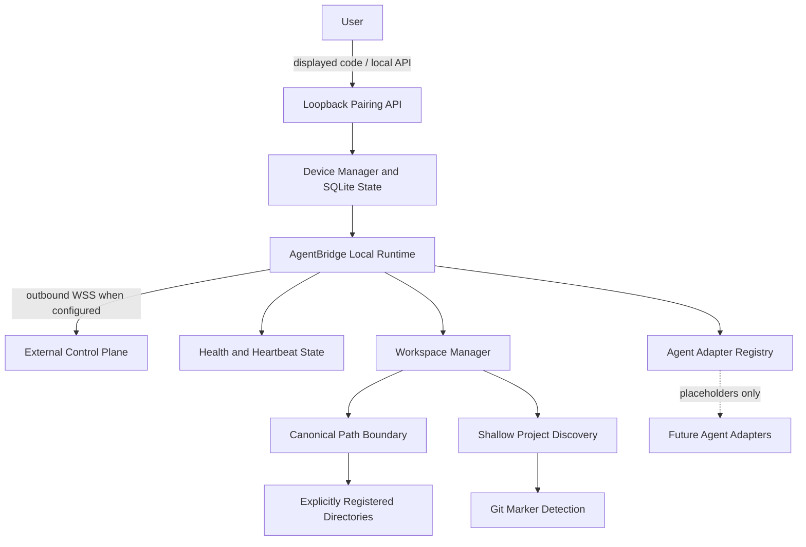

# Phase 1: Local Runtime Foundation

## What runs

Install the package in a Python 3.11+ virtual environment with `python -m pip install -e .`, then run `sutra local`. The default state directory is `%USERPROFILE%\.sutra` on Windows (`~/.sutra` elsewhere); set `SUTRA_HOME` to choose another local directory. SQLite stores the paired device ID, device name, persistent bearer token, creation time, and registered workspace roots.

The runtime binds its status and pairing HTTP API to `127.0.0.1:8765`. `GET /health` and `GET /status` return local runtime state. The temporary pairing code is generated with Python's cryptographic random source, expires after five minutes, and is accepted once by `POST /pair` with JSON `{"code":"ABCD-EFGH","device_name":"optional label"}`. A successful local pairing creates a separate random device token and stable device ID. The temporary code is discarded from memory.

**Pairing is development-only.** No AgentBridge cloud/control-plane server or identity verification protocol exists in this repository. The local endpoint checks possession of the displayed code; it does not establish trust with a remote service. State files are kept in the user's chosen home directory and rely on that directory's OS access controls; the token is not encrypted at rest. Do not expose or forward the local HTTP API.

## Outbound connection

Set `SUTRA_GATEWAY_URL` to a `wss://` endpoint before starting the runtime. Once paired, the client sends JSON heartbeat frames and authenticates with the stored bearer token. It uses WebSocket ping/pong and exponential reconnect backoff up to `SUTRA_RECONNECT_MAX_BACKOFF` seconds. There is no compatible gateway implementation in this repository, so connected status cannot be demonstrated without an external server implementing the documented heartbeat/auth contract. No inbound internet listener is created.

## Workspace registration and discovery

`sutra workspace add D:\Projects` registers an existing access root in the local SQLite database. An explicitly approved drive/share root may be used for bounded project discovery; it grants no file access by itself. Discovery walks at most four directory levels and 1,000 directories per root, stops at identified projects, and skips common data, cache, virtual-environment, and build directories. `sutra projects` reports likely projects and labels ambiguous matches as candidates. Remote file operations require a currently discovered project root and remain inside that project. No file write API, command runner, or Git operation is exposed.

The reusable `is_path_allowed(path, registered_workspaces)` function recursively decodes URL encoding (up to four passes), normalizes Windows path casing and trailing dots/spaces, expands existing 8.3 aliases, and resolves symlinks/junctions before checking containment. Drive and share roots cannot be registered. An explicit directory registration is the authorization boundary. A caller must apply this check before any future filesystem operation. The current HTTP API offers no filesystem operation at all.

## Adapters, security and logs

`sutra agents` lists placeholder entries for Antigravity, Cursor, Codex, Claude Code, Jules, and Generic CLI. Each is reported as `Not Connected` and `Not Implemented`. The adapter protocol is an extension point only. `GitManager` implements repository marker detection; status, diff, branch, stage, commit, push, and pull are not present. Structured Python logs avoid printing pairing codes or tokens. The API binds only to a loopback address. No user-controlled shell command execution is implemented.

`.gitignore` excludes `.env` and local build/runtime artifacts; `.env.example` remains a placeholder template. The Phase 1 runtime reads its settings from the process environment and does not load `.env` automatically.

## Run and verify

```powershell
python -m pip install -e .
sutra workspace add D:\Projects
sutra local
```

In another terminal, read `http://127.0.0.1:8765/health`. Pair through the loopback `/pair` endpoint using the displayed code. Tests use only the standard library: `python -m unittest discover -s tests -v`.

Build the one-file console executable on Windows:

```powershell
python -m pip install -e ".[build]"
pyinstaller --clean --noconfirm AgentBridge.spec
```

The output is `dist\AgentBridge.exe`. A Windows build requires running that command on Windows. The executable retains a console so the one-time pairing code is visible. No Windows startup/service setting is changed; start it manually.

## Architecture



Archify is not configured in this repository, and its DSL is not specified here. No Archify artifact was added.

## Not implemented

Production cloud pairing, a control plane, agent adapters (Antigravity, Cursor, Codex, Claude Code, Jules), Telegram/Discord/Slack, Git/GitHub operations, MCP, local LLMs, command execution, remote filesystem browsing, permission approvals, Windows service/startup installation, and an installer are outside Phase 1.
